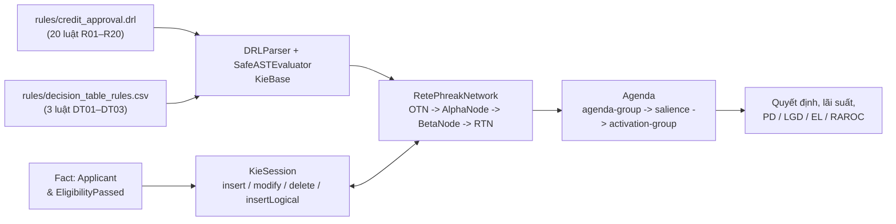

# Đồ án môn Hệ thống Hỗ trợ Ra quyết định – Nhóm 1 – Đề 08: Drools

[](https://github.com/Vipwar/dss-nhom1-de08-drools/actions/workflows/ci.yml)

- **Môn học:** Hệ thống Hỗ trợ Ra quyết định (DSS)
- **Nhóm đề tài:** Rule-based (`CLIPS` / `PROLOG` / `DROOLS`)
- **Đề tài:** Đề 08 – Công cụ DROOLS
- **Nhóm thực hiện:** Nhóm 1
- **Bài toán áp dụng:** Hỗ trợ thẩm định tín dụng cá nhân, xếp hạng rủi ro và định giá khoản vay

---

## 1. Giới thiệu

Đồ án xây dựng một hệ hỗ trợ ra quyết định dựa trên luật (Rule-Based DSS) mô phỏng kiến trúc của **Apache KIE / Drools** bằng Python chuẩn (Python 3.10+, không cần cài thêm thư viện ngoài). Hệ thống đọc trực tiếp file luật `.drl` và bảng quyết định `.csv`, thực hiện suy diễn tiến qua mạng Rete/PHREAK, tính thêm các chỉ số rủi ro tín dụng theo Basel III (`PD`, `LGD`, `EAD`, `EL`, `RAROC`) và đối chiếu kết quả với hai công cụ cùng nhóm là **CLIPS (`.clp`)** và **Prolog (`.pl`)**.



### Các phần chính đã cài đặt

1. **Bộ máy suy diễn (`engine/drools_engine.py`):**
   - `DRLParser` và `DecisionTableLoader` đọc các khai báo `package`, `declare`, `rule`, `salience`, `agenda-group`, `activation-group`, `no-loop`, `lock-on-active` từ file `.drl` và `.csv`.
   - `SafeASTEvaluator` dùng module `ast` để tính biểu thức điều kiện mà không gọi `eval()`/`compile()`, tránh lỗi chèn mã khi sửa luật trực tiếp trên giao diện web.
   - `AlphaNode` lưu cache theo `(handle_id, fact.recency)` để không tính lại điều kiện cho các Fact không đổi sau `modify()`.
   - `StrictInputSanitizer` kiểm tra dữ liệu biên (tránh chia cho 0 hoặc giá trị `NaN`/`Inf`).
   - `KieSession` hỗ trợ Truth Maintenance System (`insertLogical`): tự rút lại `EligibilityPassed` khi điều kiện gốc không còn đúng.
2. **Tập luật thẩm định 4 tầng (`rules/credit_approval.drl` & `rules/decision_table_rules.csv`):**
   - Gồm 20 luật `.drl` (`R01`–`R20`) và 3 luật bảng quyết định (`DT01`–`DT03`), chạy nối tiếp qua 4 `agenda-group`: `1-eligibility` $\rightarrow$ `2-risk-scoring` $\rightarrow$ `3-pricing-decision` $\rightarrow$ `4-dss-explanation`.
3. **Chỉ số rủi ro Basel III & Stress test (`engine/drools_engine.py`, `app.py`):**
   - Tính `PD`, `LGD`, `EAD`, `Expected Loss` ($\text{EL} = \text{PD} \times \text{LGD} \times \text{EAD}$) và `RAROC` cho từng hồ sơ.
   - Endpoint `POST /api/stress-test` giả lập giảm thu nhập, giảm giá trị tài sản đảm bảo và tăng DTI trên danh mục 15 hồ sơ để lập bảng dịch chuyển hạng rủi ro 4×4 (`TIER_A`..`TIER_D`).
4. **So sánh với CLIPS, Prolog & kiểm tra tập luật (`engine/multi_paradigm_comparator.py`):**
   - Cài đặt cùng nghiệp vụ trên `rules/credit_approval.clp` và `rules/credit_approval.pl`, đối chiếu kết quả trên 15 hồ sơ mẫu và 100 hồ sơ sinh ngẫu nhiên.
   - Kiểm tra tập luật theo 5 mục V&V (trùng lặp, xung đột, luật chết, dừng hữu hạn, độ phủ) và hỗ trợ tìm ngược phương án điều chỉnh hồ sơ (`BackwardGoalSeeker`).
   - Thư mục `java_kie_reference/` chứa dự án Maven mẫu dùng Apache KIE Drools 8 trên Java để đối chiếu cú pháp `.drl`.

---

## 2. Cách chạy chương trình

Yêu cầu Python 3.10 trở lên (chỉ dùng thư viện chuẩn, không cần `pip install`).

```bash
# Chạy toàn bộ demo (in terminal + chạy 28 test + mở giao diện web)
python demo_all.py

# Hoặc chỉ mở giao diện web (mặc định tại cổng 8000)
python app.py --port 8000

# Hoặc chỉ chạy thử trên terminal
python cli_demo.py
```

*(Trên macOS/Linux thay `python` bằng `python3`. Trên Windows có thể nhấp đúp `RUN_DEMO_WINDOWS.bat`).*

Giao diện web gồm 5 mục:
1. **Thẩm định:** Nhập hồ sơ hoặc chọn 6 hồ sơ mẫu, xem quyết định, chỉ số Basel III, sơ đồ mạng Rete, chạy từng bước (replay) và in tờ trình.
2. **What-if:** Điều chỉnh thu nhập, khoản vay, tài sản đảm bảo, điểm tín dụng, DTI để so sánh trước – sau.
3. **Chấm điểm hàng loạt:** Chấm 15 hồ sơ mẫu hoặc tải file CSV riêng (hỗ trợ chuẩn RFC 4180), chạy stress test danh mục.
4. **Sửa luật:** Xem và sửa trực tiếp `rules/credit_approval.drl`, biên dịch lại trên bộ nhớ.
5. **So sánh & kiểm tra:** Đối chiếu kết quả giữa Drools, CLIPS và Prolog; tìm phương án để hồ sơ được duyệt; xem kết quả kiểm tra tập luật (V&V).

---

## 3. Chạy kiểm thử

```bash
python -m unittest discover -s tests -v
```

Bộ test trong `tests/test_drools_engine.py` gồm 28 bài kiểm tra cho bộ đọc DRL, mạng Rete, cache AlphaNode, `SafeASTEvaluator`, TMS, 6 kịch bản mẫu, What-if, chấm điểm hàng loạt, chỉ số Basel III, stress test, API web và so sánh 3 công cụ trên 100 hồ sơ ngẫu nhiên.

---

## 4. Cấu trúc thư mục

```text
dss-nhom1-de08-drools/
├── app.py                                       # Web server & REST API
├── cli_demo.py                                  # Chạy demo trên terminal
├── demo_all.py                                  # Chạy gộp CLI + test + web
├── RUN_DEMO_WINDOWS.bat                         # Chạy nhanh trên Windows
├── engine/
│   ├── drools_engine.py                         # Bộ máy Drools, SafeAST, cache Alpha, Basel III
│   └── multi_paradigm_comparator.py             # So sánh CLIPS/Prolog, V&V, Goal-Seeker
├── rules/
│   ├── credit_approval.drl                      # 20 luật Drools (R01–R20)
│   ├── decision_table_rules.csv                 # 3 luật bảng quyết định (DT01–DT03)
│   ├── credit_approval.clp                      # Tập luật CLIPS đối chiếu
│   └── credit_approval.pl                       # Tập luật Prolog đối chiếu
├── java_kie_reference/                          # Dự án Maven mẫu dùng Drools 8 trên Java
├── data/
│   └── sample_applicants.csv                    # 15 hồ sơ mẫu (APP001–APP015)
├── static/
│   ├── index.html                               # Giao diện web
│   ├── styles.css                               # Định dạng CSS
│   └── app.js                                   # Xử lý tương tác phía trình duyệt
├── tests/
│   └── test_drools_engine.py                    # 28 unit & integration tests
├── docs/
│   ├── BAO_CAO_DO_AN_DE_08_DROOLS_NHOM_1.docx   # Báo cáo Word
│   ├── SLIDE_THUYET_TRINH_DE_08_DROOLS_NHOM_1.pptx # Slide PowerPoint
│   ├── BAO_CAO_DO_AN_DE_08_DROOLS_NHOM_1.md     # Nội dung báo cáo dạng Markdown
│   └── SLIDE_VA_KICH_BAN_BAO_VE_NHOM_1.md       # Nội dung slide & gợi ý thuyết trình
└── scripts/
    └── generate_office_docs.py                  # Script tạo lại file .docx và .pptx
```
