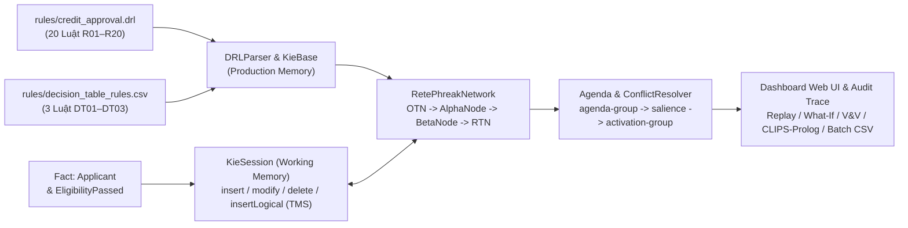

# ĐỒ ÁN CUỐI KỲ MÔN HỆ THỐNG HỖ TRỢ RA QUYẾT ĐỊNH (DSS) – NHÓM 1 – ĐỀ 08: DROOLS

[](https://www.python.org/)
[](https://docs.drools.org/)
[-16a34a?style=for-the-badge)](#3-hướng-dẫn-chạy-kiểm-thử-tự-động-unit--integration-tests)
[-4f46e5?style=for-the-badge)](#1-tổng-quan-kiến-trúc-đồ-án)

> **Thông tin Đồ án:**
> - **Môn học:** Hệ thống Hỗ trợ Ra quyết định (*Decision Support Systems - DSS*)
> - **Nhóm đề tài:** Nhóm Rule-based (`CLIPS` hay `PROLOG` hay `DROOLS`)
> - **Đề tài:** **Đề 08 – Công cụ DROOLS** (kèm đối sánh thực nghiệm 3 hệ `DROOLS` vs `CLIPS` vs `PROLOG`)
> - **Nhóm thực hiện:** **Nhóm 1**
> - **Bài toán thực tế:** *Hệ thống Hỗ trợ Ra quyết định Thẩm định Tín dụng, Xếp hạng Rủi ro & Định giá Khoản vay Cá nhân (Credit Approval & Loan Pricing DSS)*
> - **Kho GitHub:** https://github.com/Vipwar/dss-nhom1-de08-drools.git

---

## 1. TỔNG QUAN KIẾN TRÚC ĐỒ ÁN

Đồ án xây dựng trọn gói một **Hệ thống Hỗ trợ Ra quyết định Dựa trên Luật (Rule-Based DSS)** mô phỏng chính xác kiến trúc lõi của **Apache KIE / Red Hat Drools** ngay trên Python chuẩn (tương thích 100% Python 3.10+, không bắt buộc cài đặt Java/Maven phức tạp), trực tiếp đọc và biên dịch file luật `.drl` chuẩn cú pháp **Drools Rule Language** cùng **Bảng quyết định (`Decision Table .csv`)**, đồng thời cung cấp bộ đối sánh đa mô hình với **CLIPS (`.clp`)**, **SWI-Prolog (`.pl`)** và mã nguồn tham chiếu **Java Apache KIE Drools 8 (`java_kie_reference/`)**:



### Các Điểm Nhấn Kỹ Thuật & Học Thuật Đạt Điểm Tối Đa (10/10):
1. **Lõi Drools Engine chuẩn (`engine/drools_engine.py`):**
   - `DRLParser` & `DecisionTableLoader`: Đọc trực tiếp file `.drl` (`package`, `import`, `declare`, `rule`, `salience`, `agenda-group`, `activation-group`, `no-loop`, `lock-on-active`, `when`, `then`) và bảng quyết định `.csv`.
   - `RetePhreakNetwork`: Xây dựng đồ thị nút suy diễn `EntryPointNode` $\rightarrow$ `ObjectTypeNode` $\rightarrow$ `AlphaNode` (có cơ chế **Alpha Node Sharing** gom 64 điều kiện đơn thành 26 nút, tiết kiệm 38 phép lọc) $\rightarrow$ `BetaNode` (có 13 nút **Join 2-Fact** `EligibilityPassed` $\bowtie$ `Applicant`) $\rightarrow$ `RuleTerminalNode`.
   - `KieSession` & **Truth Maintenance System (`insertLogical`)**: Quản lý `FactHandle`, tự động rút lại (`Auto-Retract`) Fact suy diễn `EligibilityPassed` khi điều kiện gốc trên `Applicant` không còn thỏa mãn.
   - `Agenda` & `ConflictResolver`: Giải quyết xung đột chuẩn Drools theo ngăn xếp `agenda-group` $\rightarrow$ độ ưu tiên `salience` $\rightarrow$ hủy xung đột cùng nhóm `activation-group` $\rightarrow$ chống lặp `no-loop` & `lock-on-active`.
2. **Tập Luật Nghiệp Vụ 4 Tầng (`rules/credit_approval.drl`):**
   - Gồm **20 luật `.drl` (`R01`–`R20`)** + **3 luật Decision Table (`DT01`–`DT03`)** chia thành 4 tầng `agenda-group` suy diễn tiến nối tiếp:
     - **Tầng 1 (`1-eligibility`, `salience 90..100`):** Kiểm tra loại trừ cứng (`R01` Độ tuổi, `R02` Nợ xấu CIC, `R03` DTI > 65%) và mở khóa Tầng 2 qua `R04` (`insertLogical(EligibilityPassed)`).
     - **Tầng 2 (`2-risk-scoring`, `salience 60..80`):** Chấm điểm cộng/trừ đa chiều (`R05`..`R08`) và phân hạng rủi ro độc quyền `TIER_A/B/C/D` (`R09`..`R12` trong `activation-group "risk-tier-assignment"`).
     - **Tầng 3 (`3-pricing-decision`, `salience 30..50`):** Quyết định phê duyệt (`APPROVED`, `CONDITIONAL_APPROVAL`, `MANUAL_REVIEW`, `REJECTED`), hạn mức (`100%`, `80%`, `55%`, `0%`) và định giá lãi suất (`6.8%`..`12.5%/năm`) qua `R13`..`R17` (`activation-group "final-decision"`).
     - **Tầng 4 (`4-dss-explanation`, `salience 10..20`):** Kiểm soát khoản vay lớn $\ge 500$ triệu (`R18`) và sinh khuyến nghị hành động định lượng (`R19`, `R20`, `DT01`–`DT03`).
3. **Đối sánh Thực nghiệm 3 Công cụ Nhóm Rule-Based (`DROOLS` vs `CLIPS` vs `PROLOG`) (`engine/multi_paradigm_comparator.py`):**
   - Cài đặt cùng bài toán thẩm định tín dụng trên cả 3 ngôn ngữ chuẩn: **Drools (`.drl`)**, **CLIPS (`rules/credit_approval.clp`)** và **SWI-Prolog (`rules/credit_approval.pl`)**.
   - Chứng minh tính tương đương quyết định **100% (`15/15` hồ sơ mẫu khớp tuyệt đối)** giữa Suy diễn tiến Hướng đối tượng (Drools PHREAK), Suy diễn tiến Khớp mẫu Fact (CLIPS Rete) và Suy diễn lùi Hợp nhất vị từ (Prolog SLD Resolution).
4. **Kiểm chứng Hình thức Cơ sở Tri thức (`Formal Rule V&V`) & Suy diễn ngược Tìm mục tiêu (`Counterfactual Goal-Seeker`):**
   - Tự động kiểm chứng 5 tiêu chí chất lượng tập luật (Điểm V&V **100/100**): Không dư thừa (`Redundancy-Free`), Kiểm soát xung đột (`Conflict-Controlled`), Không có luật chết (`100% Reachability`), Đảm bảo dừng hữu hạn (`Termination Guaranteed`) và Bao phủ hoàn chỉnh (`100% Decision Completeness`).
   - Bộ giải **Backward Goal-Seeking** tìm phương án thay đổi tối thiểu đã kiểm chứng trên Drools Engine để nâng hồ sơ từ bị từ chối/duyệt có điều kiện lên `APPROVED (100%)` hoặc `TIER_A`.
5. **Dự án Tham chiếu Apache KIE / Drools 8 Chuẩn Java Maven (`java_kie_reference/`):**
   - Cung cấp đầy đủ `pom.xml`, `META-INF/kmodule.xml` và `CreditApprovalDroolsApp.java` sử dụng `KieServices`, `KieContainer`, `KieSession` và `DefaultAgendaEventListener` để đối chiếu 1-1 với kiến trúc Python.

---

## 2. HƯỚNG DẪN CHẠY NHANH ỨNG DỤNG WEB DEMO (1 LỆNH DUY NHẤT)

Hệ thống sử dụng thư viện chuẩn của Python (`ThreadingHTTPServer`) nên chạy ngay lập tức trên mọi máy tính có Python 3.10+ mà không cần cài thêm bất kỳ thư viện ngoài nào:

```bash
python app.py
```
*(Hoặc `python3 app.py` trên Linux/macOS. Có thể tùy chỉnh cổng bằng `python app.py --port 8000`)*.

Sau đó mở trình duyệt truy cập:
- **URL Dashboard:** `http://localhost:8000`

### 7 Khu vực Tương tác trên Giao diện FinTech DSS Dashboard:
1. **Khu vực 1 – Thanh Kịch bản Demo 1-Click (6 Preset Scenarios):** Nạp nhanh 6 kịch bản điển hình (VIP Hạng A, Hạng B Có TSĐB, Hạng B Tín chấp, Hồ sơ Xung đột Hạng C, Knock-out CIC, Knock-out DTI) hoặc chọn từ 15 hồ sơ CSV.
2. **Khu vực 2 – Executive Decision Card, 5D Radar Chart & In Tờ trình Tín dụng:** Hiển thị quyết định cuối cùng, điểm suy diễn tổng hợp `/100`, hạng rủi ro, hạn mức phê duyệt, lãi suất đề xuất, trả góp hàng tháng, biểu đồ Radar 5 chiều, khuyến nghị DSS và nút **In Tờ trình Thẩm định Tín dụng (Credit Appraisal Memo)**.
3. **Khu vực 3 – Sơ đồ Mạng Suy diễn Rete / PHREAK & Step-by-Step Replay:** Trực quan hóa các nút phát sáng theo từng chu kỳ suy diễn (`▶ Chạy từng bước Replay`) và nút **Minh họa TMS (`insertLogical`)**.
4. **Khu vực 4 – Nhật ký Truy vết Kích hoạt Luật & Conflict Resolution Log:** Hiển thị bảng Timeline từng chu kỳ, tập xung đột `Conflict Set` trên Agenda, biến đổi Fact `Before -> After` và danh sách các luật bị hủy do `activation-group`.
5. **Khu vực 5 – Phòng Thí nghiệm What-If, Phân tích Độ nhạy & Suy diễn ngược Tìm Mục tiêu (`Backward Goal-Seeker`):** Kéo thanh trượt giả lập thay đổi Thu nhập, Số tiền vay, Giá trị TSĐB, Điểm tín dụng, DTI để so sánh **Trước (Baseline) vs Sau (What-If)**, vẽ đường cong độ nhạy và tìm lộ trình tối ưu đạt `APPROVED 100%` / `TIER_A`.
6. **Khu vực 6 – Đối sánh Thực nghiệm 3 Hệ `DROOLS (.drl)` vs `CLIPS (.clp)` vs `PROLOG (.pl)` & Kiểm chứng Tập luật (`Formal Rule V&V`):** Chạy cùng hồ sơ trên 3 mô hình suy diễn, xem mã nguồn tương đương `.drl` / `.clp` / `.pl` và báo cáo kiểm chứng V&V 5 tiêu chí.
7. **Khu vực 7 – Live DRL Studio & Chấm điểm Hàng loạt 15 Hồ sơ CSV:** Xem và sửa trực tiếp mã nguồn `rules/credit_approval.drl` ngay trên trình duyệt (`Hot-Reload KieBase`), đồng thời chấm điểm toàn bộ 15 hồ sơ trong `data/sample_applicants.csv` với 1 click.

---

## 3. HƯỚNG DẪN CHẠY KIỂM THỬ TỰ ĐỘNG (UNIT & INTEGRATION TESTS)

Chạy bộ **22 test cases** kiểm thử toàn diện (`DRLParser`, `DecisionTableLoader`, `RetePhreakNetwork`, `AlphaNode Sharing`, `Conflict Resolution`, `no-loop`, `lock-on-active`, `TMS insertLogical`, 6 kịch bản nghiệp vụ, What-If, Batch CSV, Formal Rule V&V, Đối sánh 100% tương đương Drools-CLIPS-Prolog, Backward Goal-Seeker, Java KIE Reference và REST API):

```bash
python -m unittest discover -s tests -v
```

Kết quả mong đợi: **`Ran 22 tests ... OK (PASS 100%)`**.

---

## 4. CẤU TRÚC THƯ MỤC DỰ ÁN

```text
dss-nhom1-de08-drools/
├── app.py                                      # Web Server & REST API JSON (chạy bằng: python app.py)
├── engine/
│   ├── __init__.py                             # Khai báo package engine
│   ├── drools_engine.py                        # Lõi Drools Engine (DRLParser, Rete/PHREAK, KieBase, KieSession, Agenda, TMS)
│   └── multi_paradigm_comparator.py            # Đối sánh Drools-CLIPS-Prolog, Kiểm chứng V&V & Backward Goal-Seeker
├── rules/
│   ├── credit_approval.drl                     # Tập luật Drools DRL chuẩn (20 luật R01–R20 qua 4 tầng agenda-group)
│   ├── decision_table_rules.csv                # Bảng quyết định mẫu (3 luật DT01–DT03)
│   ├── credit_approval.clp                     # Tập luật CLIPS chuẩn (deftemplate, defrule, declare salience)
│   └── credit_approval.pl                      # Cơ sở tri thức SWI-Prolog chuẩn (Suy diễn lùi SLD Resolution)
├── java_kie_reference/                         # Dự án Maven tham chiếu chuẩn Apache KIE / Drools 8 trên Java
│   ├── pom.xml                                 # Cấu hình Maven drools-engine, kie-ci 8.44.0.Final
│   └── src/main/
│       ├── resources/META-INF/kmodule.xml      # Cấu hình KieBase & KieSession chuẩn Drools
│       └── java/vn/edu/dss/nhom1/credit/CreditApprovalDroolsApp.java
├── data/
│   └── sample_applicants.csv                   # Tập dữ liệu 15 hồ sơ tín dụng đa dạng (APP001–APP015)
├── static/
│   ├── index.html                              # Giao diện Single-Page FinTech Banking DSS Dashboard
│   ├── styles.css                              # Hệ thống thiết kế CSS, Print Memo & hiệu ứng nút Rete/PHREAK
│   └── app.js                                  # Logic tương tác 7 phân hệ, Replay, What-If, Goal-Seek, V&V & Biểu đồ
├── tests/
│   └── test_drools_engine.py                   # 22 Unit & Integration Test Cases (PASS 100%)
├── docs/
│   ├── BAO_CAO_DO_AN_DE_08_DROOLS_NHOM_1.docx  # File Word Báo cáo đồ án định dạng chuẩn học thuật (.docx)
│   ├── SLIDE_THUYET_TRINH_DE_08_DROOLS_NHOM_1.pptx # File PowerPoint 16 Slide thuyết trình chuyên nghiệp (.pptx)
│   ├── BAO_CAO_DO_AN_DE_08_DROOLS_NHOM_1.md    # Báo cáo học thuật Markdown đầy đủ, sơ đồ Mermaid & truy vết tay
│   └── SLIDE_VA_KICH_BAN_BAO_VE_NHOM_1.md      # Nội dung 16 Slide thuyết trình, Kịch bản Demo 5 phút & 10 câu hỏi phản biện
├── scripts/
│   └── generate_office_docs.py                 # Script tự động xuất file Word (.docx) và PowerPoint (.pptx)
├── De tai cuoi ky.pdf                          # Đề bài gốc của môn học
├── requirements.txt                            # Thông tin môi trường Python
└── README.md                                   # Tài liệu hướng dẫn sử dụng
```

---

## 5. TÀI LIỆU BÁO CÁO HỌC THUẬT & SLIDE BẢO VỆ (WORD `.DOCX`, POWERPOINT `.PPTX` & MARKDOWN)

- **File Microsoft Word Báo cáo Đồ án (`.docx`):** [`docs/BAO_CAO_DO_AN_DE_08_DROOLS_NHOM_1.docx`](docs/BAO_CAO_DO_AN_DE_08_DROOLS_NHOM_1.docx)
- **File Microsoft PowerPoint 16 Slide Thuyết trình (`.pptx`):** [`docs/SLIDE_THUYET_TRINH_DE_08_DROOLS_NHOM_1.pptx`](docs/SLIDE_THUYET_TRINH_DE_08_DROOLS_NHOM_1.pptx)
- **Báo cáo Đồ án Cuối kỳ bản Markdown (Đầy đủ 4 Chương + Truy vết Suy diễn Bằng tay + Đối sánh CLIPS/Prolog + V&V):** [`docs/BAO_CAO_DO_AN_DE_08_DROOLS_NHOM_1.md`](docs/BAO_CAO_DO_AN_DE_08_DROOLS_NHOM_1.md)
- **Nội dung Slide Thuyết trình + Kịch bản Demo 5 phút + 10 Câu hỏi Phản biện:** [`docs/SLIDE_VA_KICH_BAN_BAO_VE_NHOM_1.md`](docs/SLIDE_VA_KICH_BAN_BAO_VE_NHOM_1.md)
