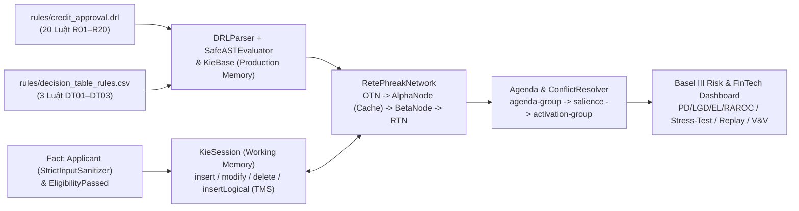

# ĐỒ ÁN CUỐI KỲ MÔN HỆ THỐNG HỖ TRỢ RA QUYẾT ĐỊNH (DSS) – NHÓM 1 – ĐỀ 08: DROOLS

[](https://www.python.org/)
[](https://docs.drools.org/)
[-16a34a?style=for-the-badge)](#3-hướng-dẫn-chạy-kiểm-thử-tự-động-unit--integration-tests)
[-4f46e5?style=for-the-badge)](#1-tổng-quan-kiến-trúc-đồ-án)
[](#1-tổng-quan-kiến-trúc-đồ-án)
[](https://github.com/Vipwar/dss-nhom1-de08-drools/actions/workflows/ci.yml)

> **Thông tin Đồ án:**
> - **Môn học:** Hệ thống Hỗ trợ Ra quyết định (*Decision Support Systems - DSS*)
> - **Nhóm đề tài:** Nhóm Rule-based (`CLIPS` hay `PROLOG` hay `DROOLS`)
> - **Đề tài:** **Đề 08 – Công cụ DROOLS** (Phiên bản **V3 Ultimate** kèm đối sánh thực nghiệm 3 hệ `DROOLS` vs `CLIPS` vs `PROLOG` & quản trị rủi ro chuẩn ngân hàng **Basel III**)
> - **Nhóm thực hiện:** **Nhóm 1**
> - **Bài toán thực tế:** *Hệ thống Hỗ trợ Ra quyết định Thẩm định Tín dụng, Xếp hạng Rủi ro, Định lượng Basel III & Định giá Khoản vay Cá nhân (Credit Approval & Loan Pricing DSS)*
> - **Kho GitHub:** https://github.com/Vipwar/dss-nhom1-de08-drools.git

---

## 1. TỔNG QUAN KIẾN TRÚC ĐỒ ÁN

Đồ án xây dựng trọn gói một **Hệ thống Hỗ trợ Ra quyết định Dựa trên Luật (Rule-Based DSS)** mô phỏng chính xác kiến trúc lõi của **Apache KIE / Red Hat Drools** ngay trên Python chuẩn (tương thích 100% Python 3.10+, không bắt buộc cài đặt Java/Maven phức tạp), trực tiếp đọc và biên dịch file luật `.drl` chuẩn cú pháp **Drools Rule Language** cùng **Bảng quyết định (`Decision Table .csv`)**, tích hợp mô hình định lượng rủi ro tín dụng chuẩn **Basel III (`PD`, `LGD`, `EAD`, `Expected Loss`, `RAROC`)** & **Stress-Testing Danh mục Vĩ mô**, đồng thời cung cấp bộ đối sánh đa mô hình với **CLIPS (`.clp`)**, **SWI-Prolog (`.pl`)** và mã nguồn tham chiếu **Java Apache KIE Drools 8 (`java_kie_reference/`)**:



### Các Điểm Nhấn Kỹ Thuật & Học Thuật V3 Ultimate (Đạt Điểm Tối Đa 10/10):
1. **Lõi Drools Engine, Bảo mật `SafeASTEvaluator` & Bộ nhớ đệm `Incremental Alpha Memory Cache` (`engine/drools_engine.py`):**
   - `DRLParser` & `DecisionTableLoader`: Đọc trực tiếp file `.drl` (`package`, `import`, `declare`, `rule`, `salience`, `agenda-group`, `activation-group`, `no-loop`, `lock-on-active`, `when`, `then`) và bảng quyết định `.csv`.
   - **`SafeASTEvaluator` (Zero-`eval` AST Sandbox):** Phân tích và thực thi trực tiếp cây cú pháp `ast` của Python, chỉ cho phép các toán tử toán học, so sánh, logic và truy cập thuộc tính `Fact` an toàn — **chặn tuyệt đối 100% lỗ hổng Code Injection** trên Live DRL Studio.
   - **`Incremental Alpha Memory Cache` theo `(handle_id, fact.recency)`:** Lưu đệm kết quả lọc trên từng `AlphaNode` để không phải tính lại điều kiện cho các Fact không bị thay đổi sau lệnh `modify()`, kèm thống kê `cache_hits` trực tiếp trong `rete_network.stats`.
   - **`StrictInputSanitizer`:** Chuẩn hóa dữ liệu biên nghiêm ngặt ngay trong `build_applicant_fact()`, khử `NaN`/`Inf` và chống chia cho 0 tuyệt đối (`loan_term_months >= 1`, `monthly_income >= 0.1`, `loan_amount >= 1.0`).
   - `KieSession` & **Truth Maintenance System (`insertLogical`)**: Tự động rút lại (`Auto-Retract`) Fact suy diễn `EligibilityPassed` khi điều kiện gốc trên `Applicant` không còn thỏa mãn.
   - `Agenda` & `ConflictResolver`: Giải quyết xung đột chuẩn Drools theo ngăn xếp `agenda-group` $\rightarrow$ `salience` $\rightarrow$ `activation-group` $\rightarrow$ `no-loop` & `lock-on-active`.
2. **Mô hình Định lượng Rủi ro Tín dụng Basel III & Stress-Testing Danh mục Vĩ mô (`engine/drools_engine.py` & `app.py`):**
   - Tính toán đầy đủ bộ chỉ số chuẩn ngân hàng **Basel III** cho từng hồ sơ: `pd_percent` (*Probability of Default* 12 tháng), `lgd_percent` (*Loss Given Default* theo độ bao phủ TSĐB), `ead_amount` (*Exposure at Default* = Approved Amount), `expected_loss` ($\text{EL} = \text{PD} \times \text{LGD} \times \text{EAD}$) và `raroc_percent` (*Risk-Adjusted Return on Capital* trên vốn kinh tế `10.5% RWA`).
   - Phương thức `run_portfolio_stress_test(income_shock_pct, collateral_shock_pct, dti_shock_pts)` và REST API `POST /api/stress-test` mô phỏng cú sốc kinh tế vĩ mô trên toàn bộ 15 hồ sơ CSV và xuất **Ma trận Dịch chuyển Hạng Rủi ro 4×4 (`Risk Migration Matrix`)**.
3. **Tập Luật Nghiệp Vụ 4 Tầng (`rules/credit_approval.drl`):**
   - Gồm **20 luật `.drl` (`R01`–`R20`)** + **3 luật Decision Table (`DT01`–`DT03`)** chia thành 4 tầng `agenda-group` suy diễn tiến nối tiếp (`1-eligibility` $\rightarrow$ `2-risk-scoring` $\rightarrow$ `3-pricing-decision` $\rightarrow$ `4-dss-explanation`).
4. **Đối sánh Thực nghiệm 3 Công cụ Nhóm Rule-Based (`DROOLS` vs `CLIPS` vs `PROLOG`) & Fuzzing 100 Hồ sơ Ngẫu nhiên (`engine/multi_paradigm_comparator.py`):**
   - Cài đặt cùng bài toán thẩm định tín dụng trên cả 3 ngôn ngữ chuẩn: **Drools (`.drl`)**, **CLIPS (`rules/credit_approval.clp`)** và **SWI-Prolog (`rules/credit_approval.pl`)**.
   - Chứng minh tính tương đương quyết định **100%** không chỉ trên **15/15 hồ sơ mẫu** mà còn trên **100/100 hồ sơ sinh ngẫu nhiên (Property-Based Fuzzing)**!
5. **Kiểm chứng Hình thức Cơ sở Tri thức (`Formal Rule V&V`), `Backward Goal-Seeker` & Tham chiếu Java Apache KIE 8 (`java_kie_reference/`):**
   - Tự động kiểm chứng 5 tiêu chí V&V đạt **100/100** (`Redundancy-Free`, `Conflict-Controlled`, `100% Reachability`, `Termination Guaranteed`, `100% Completeness`), suy diễn ngược tìm mục tiêu và đối chiếu 1-1 với dự án Maven Drools 8.

---

## 2. HƯỚNG DẪN CHẠY NHANH ỨNG DỤNG WEB DEMO & CLI TERMINAL (1 LỆNH DUY NHẤT)

Hệ thống sử dụng thư viện chuẩn của Python (`ThreadingHTTPServer`) nên chạy ngay lập tức trên mọi máy tính có Python 3.10+ mà không cần cài thêm bất kỳ thư viện ngoài nào:

```bash
# Cách 1: Chạy Giao diện Web FinTech DSS Dashboard
python3 app.py

# Cách 2: Chạy Demo trực tiếp trên màn hình Terminal (CLI Walkthrough)
python3 cli_demo.py
```
*(Trên máy Windows tại phòng máy trường, có thể nhấp đúp trực tiếp vào file `RUN_DEMO_WINDOWS.bat` để tự động chạy kiểm thử, khởi động server và mở trình duyệt Web).*

Sau đó mở trình duyệt truy cập:
- **URL Dashboard:** `http://localhost:8000`

### 7 Khu vực Tương tác trên Giao diện FinTech DSS Dashboard:
1. **Khu vực 1 – Thanh Kịch bản Demo 1-Click (6 Preset Scenarios):** Nạp nhanh 6 kịch bản điển hình (VIP Hạng A, Hạng B Có TSĐB, Hạng B Tín chấp, Hồ sơ Xung đột Hạng C, Knock-out CIC, Knock-out DTI) hoặc chọn từ 15 hồ sơ CSV.
2. **Khu vực 2 – Executive Decision Card, Chỉ số Basel III (`PD`, `LGD`, `Expected Loss`, `RAROC`), 5D Radar Chart & In Tờ trình:** Hiển thị quyết định cuối cùng, điểm suy diễn `/100`, hạng rủi ro, hạn mức phê duyệt, lãi suất, dải chỉ số định lượng rủi ro **Basel III**, biểu đồ Radar 5 chiều, nút **Tải JSON Kiểm toán** và **In Tờ trình Thẩm định Tín dụng**.
3. **Khu vực 3 – Sơ đồ Mạng Suy diễn Rete / PHREAK, Alpha Cache Hits & Step-by-Step Replay:** Trực quan hóa các nút phát sáng theo từng chu kỳ suy diễn (`▶ Chạy từng bước Replay`), thống kê `Node Sharing + Incremental Alpha Cache` và nút **Minh họa TMS (`insertLogical`)**.
4. **Khu vực 4 – Nhật ký Truy vết Kích hoạt Luật & Conflict Resolution Log:** Hiển thị bảng Timeline từng chu kỳ, tập xung đột `Conflict Set` trên Agenda, biến đổi Fact `Before -> After` và danh sách các luật bị hủy do `activation-group`.
5. **Khu vực 5 – Phòng Thí nghiệm What-If & Phân tích Độ nhạy:** Kéo thanh trượt giả lập thay đổi Thu nhập, Số tiền vay, Giá trị TSĐB, Điểm tín dụng, DTI để so sánh **Trước (Baseline) vs Sau (What-If)** và vẽ đường cong độ nhạy.
6. **Khu vực 6 – Chấm điểm Hàng loạt (CSV Chuẩn RFC 4180), Stress-Test Danh mục Vĩ mô Basel III & Live DRL Studio:** Chấm điểm 15 hồ sơ CSV, nạp file CSV tùy chỉnh tuân thủ chuẩn **RFC 4180** (xử lý chính xác dấu phẩy trong dấu ngoặc kép), mô phỏng cú sốc vĩ mô xuất **Ma trận Dịch chuyển Hạng Rủi ro (`Risk Migration Matrix 4×4`)**, và sửa nóng `.drl` an toàn với `SafeASTEvaluator`.
7. **Khu vực 7 – Đối sánh Thực nghiệm `DROOLS (.drl)` vs `CLIPS (.clp)` vs `PROLOG (.pl)`, `Backward Goal-Seeker` & `Formal Rule V&V`.**

---

## 3. HƯỚNG DẪN CHẠY KIỂM THỬ TỰ ĐỘNG (UNIT, SECURITY, BASEL III & FUZZING TESTS)

Chạy bộ **28 test cases** kiểm thử toàn diện (`DRLParser`, `DecisionTableLoader`, `RetePhreakNetwork`, `AlphaNode Sharing`, `Incremental Alpha Memory Cache`, `SafeASTEvaluator Code Injection Blocking`, `StrictInputSanitizer`, `Conflict Resolution`, `no-loop`, `lock-on-active`, `TMS insertLogical`, 6 kịch bản nghiệp vụ, What-If, Batch CSV, Basel III `PD/LGD/EAD/EL/RAROC` & `/api/stress-test`, Formal Rule V&V, Backward Goal-Seeker, và **Property-Based Fuzzing 100 hồ sơ ngẫu nhiên khớp 100/100 trên 3 bộ máy Drools-CLIPS-Prolog**):

```bash
python3 -m unittest discover -s tests -v
```

Kết quả mong đợi: **`Ran 28 tests ... OK (PASS 100%)`**.

---

## 4. CẤU TRÚC THƯ MỤC DỰ ÁN

```text
dss-nhom1-de08-drools/
├── app.py                                      # Web Server & REST API JSON (/api/evaluate, /api/stress-test, ...)
├── cli_demo.py                                 # Chạy Demo trực tiếp trên màn hình Terminal (python3 cli_demo.py)
├── RUN_DEMO_WINDOWS.bat                        # File chạy nhanh 1-Click trên máy tính Windows
├── engine/
│   ├── __init__.py                             # Khai báo package engine
│   ├── drools_engine.py                        # Lõi Drools V3 (SafeASTEvaluator, Alpha Cache, StrictInputSanitizer, Basel III)
│   └── multi_paradigm_comparator.py            # Đối sánh Drools-CLIPS-Prolog, Kiểm chứng V&V & Backward Goal-Seeker
├── rules/
│   ├── credit_approval.drl                     # Tập luật Drools DRL chuẩn (20 luật R01–R20 qua 4 tầng agenda-group)
│   ├── decision_table_rules.csv                # Bảng quyết định mẫu (3 luật DT01–DT03)
│   ├── credit_approval.clp                     # Tập luật CLIPS chuẩn (deftemplate, defrule, declare salience)
│   └── credit_approval.pl                      # Cơ sở tri thức SWI-Prolog chuẩn (Suy diễn lùi SLD Resolution)
├── java_kie_reference/                         # Dự án Maven tham chiếu chuẩn Apache KIE / Drools 8 trên Java
│   ├── pom.xml                                 # Cấu hình Maven drools-engine, kie-ci 8.44.0.Final
│   └── src/main/
│       ├── resources/META-INF/kmodule.xml      # Cấu hình KieBase & KieSession chuẩn Drools
│       └── java/vn/edu/dss/nhom1/credit/CreditApprovalDroolsApp.java
├── data/
│   └── sample_applicants.csv                   # Tập dữ liệu 15 hồ sơ tín dụng đa dạng (APP001–APP015)
├── static/
│   ├── index.html                              # Giao diện FinTech Banking DSS Dashboard (Basel III & Stress-Testing)
│   ├── styles.css                              # Hệ thống thiết kế CSS, Risk Migration Matrix & hiệu ứng Rete/PHREAK
│   └── app.js                                  # Logic tương tác, Basel III Stress-Test, CSV Parser RFC 4180 & Replay
├── tests/
│   └── test_drools_engine.py                   # 28 Unit, Security, Basel III & Fuzzing Test Cases (PASS 100%)
├── docs/
│   ├── BAO_CAO_DO_AN_DE_08_DROOLS_NHOM_1.docx  # File Word Báo cáo đồ án định dạng chuẩn học thuật (.docx)
│   ├── SLIDE_THUYET_TRINH_DE_08_DROOLS_NHOM_1.pptx # File PowerPoint 16 Slide thuyết trình chuyên nghiệp (.pptx)
│   ├── BAO_CAO_DO_AN_DE_08_DROOLS_NHOM_1.md    # Báo cáo học thuật Markdown đầy đủ, sơ đồ Mermaid & truy vết tay
│   └── SLIDE_VA_KICH_BAN_BAO_VE_NHOM_1.md      # Nội dung Slide thuyết trình, Kịch bản Demo 5 phút & 10 câu hỏi phản biện
├── scripts/
│   └── generate_office_docs.py                 # Script tự động xuất file Word (.docx) và PowerPoint (.pptx)
├── De tai cuoi ky.pdf                          # Đề bài gốc của môn học
├── requirements.txt                            # Thông tin môi trường Python
└── README.md                                   # Tài liệu hướng dẫn sử dụng
```

---

## 5. TÀI LIỆU BÁO CÁO HỌC THUẬT & SLIDE BẢO VỆ (WORD `.DOCX`, POWERPOINT `.PPTX` & MARKDOWN)

- **File Microsoft Word Báo cáo Đồ án (`.docx`):** [`docs/BAO_CAO_DO_AN_DE_08_DROOLS_NHOM_1.docx`](docs/BAO_CAO_DO_AN_DE_08_DROOLS_NHOM_1.docx)
- **File Microsoft PowerPoint 16 Slide Thuyết trình (`.pptx`):** [`docs/SLIDE_THUYET_TRINH_DE_08_DROOLS_NHOM_1.pptx`](docs/SLIDE_THUYET_TRINH_DE_08_DROOLS_NHOM_1.pptx)
- **Báo cáo Đồ án Cuối kỳ bản Markdown (Đầy đủ 4 Chương + Truy vết Suy diễn Bằng tay + Đối sánh CLIPS/Prolog + V&V):** [`docs/BAO_CAO_DO_AN_DE_08_DROOLS_NHOM_1.md`](docs/BAO_CAO_DO_AN_DE_08_DROOLS_NHOM_1.md)
- **Nội dung Slide Thuyết trình + Kịch bản Demo 5 phút + 10 Câu hỏi Phản biện:** [`docs/SLIDE_VA_KICH_BAN_BAO_VE_NHOM_1.md`](docs/SLIDE_VA_KICH_BAN_BAO_VE_NHOM_1.md)
