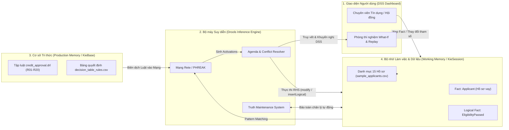
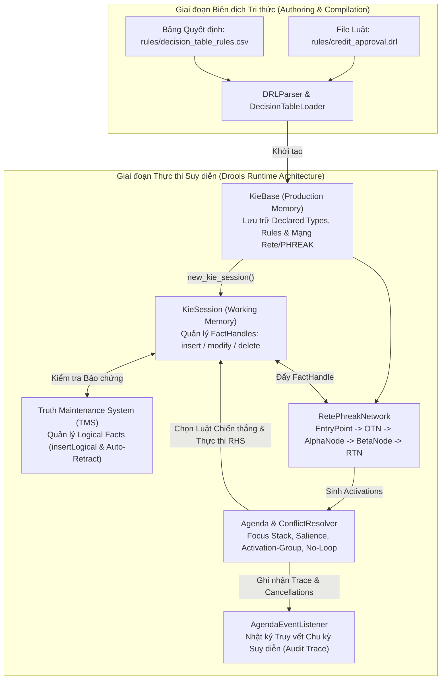
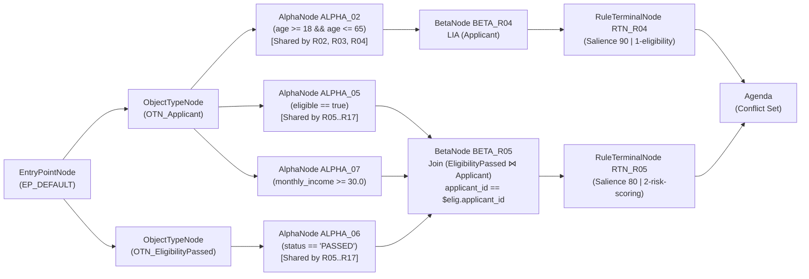
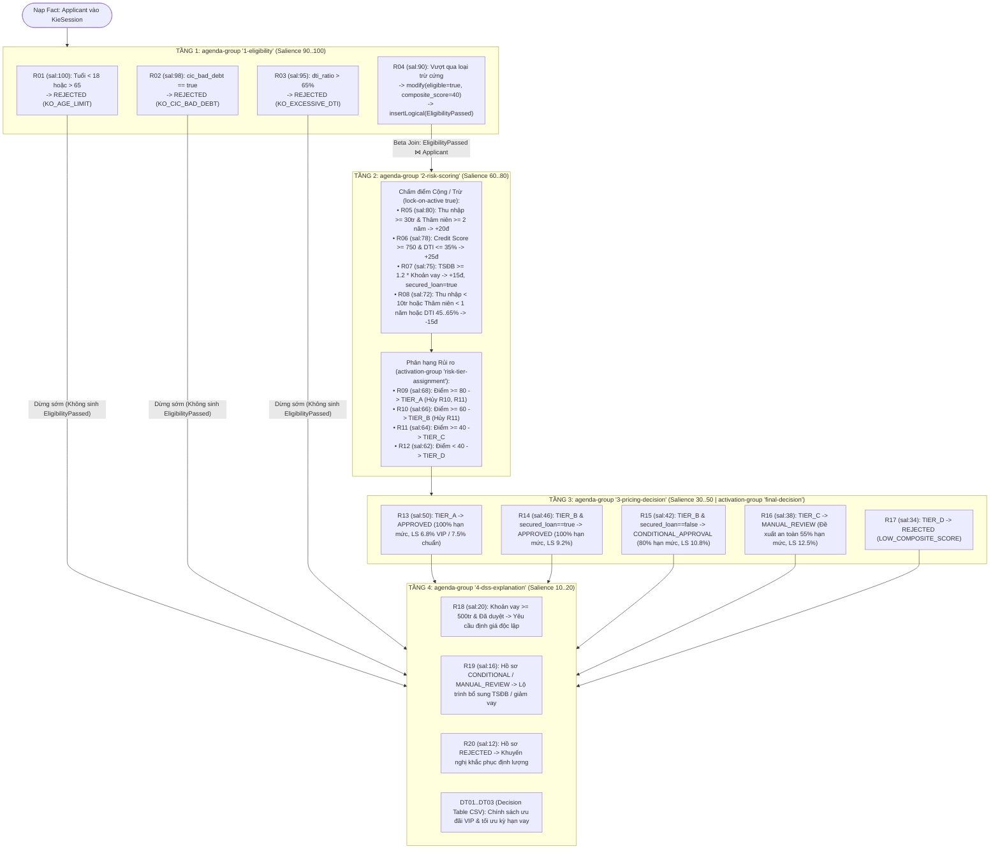

# BÁO CÁO ĐỒ ÁN CUỐI KỲ MÔN HỆ THỐNG HỖ TRỢ RA QUYẾT ĐỊNH (DECISION SUPPORT SYSTEMS)

- **Đề tài:** ĐỀ 08 – TÌM HIỂU CÔNG CỤ DROOLS TRONG NHÓM RULE-BASED DSS VÀ XÂY DỰNG HỆ THỐNG HỖ TRỢ RA QUYẾT ĐỊNH THẨM ĐỊNH TÍN DỤNG & ĐỊNH GIÁ KHOẢN VAY CÁ NHÂN
- **Nhóm đề tài:** Nhóm Rule-based (`CLIPS` hay `PROLOG` hay `DROOLS`)
- **Nhóm thực hiện:** Nhóm 1
- **Kho mã nguồn GitHub:** https://github.com/Vipwar/dss-nhom1-de08-drools.git

---

## MỤC LỤC

1. [CHƯƠNG 1: TỔNG QUAN VỀ RULE-BASED DSS VÀ CÔNG CỤ DROOLS](#chương-1-tổng-quan-về-rule-based-dss-và-công-cụ-drools)
   - 1.1. Hệ thống Hỗ trợ Ra quyết định Dựa trên Tri thức / Luật (Knowledge/Rule-Based DSS)
   - 1.2. Giới thiệu Nền tảng Apache KIE / Red Hat Drools
   - 1.3. So sánh Chuyên sâu các Công cụ trong Nhóm Rule-Based: Drools vs CLIPS vs Prolog
2. [CHƯƠNG 2: KIẾN TRÚC, THÀNH PHẦN VÀ CƠ CHẾ SUY DIỄN CỦA DROOLS](#chương-2-kiến-trúc-thành-phần-và-cơ-chế-suy-diễn-của-drools)
   - 2.1. Kiến trúc Tổng thể của Drools Rule Engine (`KieBase`, `KieSession`, `Agenda`, `TMS`)
   - 2.2. Sự Tiến hóa Thuật toán So khớp Mẫu: Từ Rete → ReteOO → PHREAK
   - 2.3. Cấu trúc Đồ thị Nút Suy diễn (`OTN`, `AlphaNode`, `BetaNode`, `RuleTerminalNode`)
   - 2.4. Cơ chế Quản lý `Agenda` và Chiến lược Giải quyết Xung đột (`Conflict Resolution`)
   - 2.5. Suy diễn Tiến (`Forward Chaining`) vs Suy diễn Lùi (`Backward Chaining`)
   - 2.6. Hệ thống Bảo toàn Chân lý (`Truth Maintenance System - TMS` & `insertLogical`)
   - 2.7. Cú pháp `Drools Rule Language (.drl)` và Bảng Quyết định (`Decision Tables`)
3. [CHƯƠNG 3: MÔ TẢ BÀI TOÁN VÍ DỤ, THIẾT KẾ TẬP LUẬT `.DRL` VÀ TRUY VẾT SUY DIỄN](#chương-3-mô-tả-bài-toán-ví-dụ-thiết-kế-tập-luật-drl-và-truy-vết-suy-diễn)
   - 3.1. Phát biểu Bài toán DSS: Thẩm định Tín dụng, Xếp hạng Rủi ro & Định giá Khoản vay Cá nhân
   - 3.2. Mô hình hóa Dữ liệu (`Fact Model`: `Applicant` & `EligibilityPassed`)
   - 3.3. Thiết kế Kiến trúc Suy diễn Tiến 4 Tầng (`Multi-Stage Forward Chaining Pipeline`)
   - 3.4. Bảng Đặc tả Đầy đủ Tập Luật Nghiệp vụ (`R01`–`R20` và Decision Table `DT01`–`DT03`)
   - 3.5. Truy vết Suy diễn Từng bước Bằng tay (`Manual Step-by-Step Trace`) cho 3 Kịch bản Điển hình
4. [CHƯƠNG 4: XÂY DỰNG ỨNG DỤNG DEMO, THỰC NGHIỆM, ĐỐI CHIẾU VÀ ĐÁNH GIÁ](#chương-4-xây-dựng-ứng-dụng-demo-thực-nghiệm-đối-chiếu-và-đánh-giá)
   - 4.1. Kiến trúc Triển khai Bộ máy Thực thi `.drl` và Web Dashboard trên Python
   - 4.2. Các Phân hệ Tương tác của Giao diện Demo FinTech DSS Dashboard
   - 4.3. Kết quả Thực nghiệm Danh mục 15 Hồ sơ Tín dụng (`data/sample_applicants.csv`)
   - 4.4. Đối chiếu Kết quả Thực thi trên Máy với Truy vết Bằng tay
   - 4.5. Kết quả Kiểm thử Tự động Toàn diện (`17/17 Unit & Integration Tests PASS 100%`)
   - 4.6. Đánh giá Ưu điểm, Hạn chế và Hướng Phát triển
5. [TÀI LIỆU THAM KHẢO](#tài-liệu-tham-khảo)

---

## CHƯƠNG 1: TỔNG QUAN VỀ RULE-BASED DSS VÀ CÔNG CỤ DROOLS

### 1.1. Hệ thống Hỗ trợ Ra quyết định Dựa trên Tri thức / Luật (Knowledge/Rule-Based DSS)

Trong phân loại kinh điển của Turban et al. về **Hệ thống Hỗ trợ Ra quyết định (Decision Support Systems - DSS)**, hệ thống được chia thành 5 nhóm chính: *Data-driven DSS*, *Model-driven DSS*, *Knowledge-driven (Rule-based) DSS*, *Document-driven DSS* và *Communications-driven DSS*. Trong đó, **Knowledge-driven / Rule-based DSS** là hệ thống tích hợp tri thức chuyên gia dưới dạng các luật suy diễn `IF <Điều kiện - LHS> THEN <Hành động/Kết luận - RHS>` nhằm hỗ trợ nhà quản trị giải quyết các bài toán bán cấu trúc (semi-structured) và phi cấu trúc (unstructured) đòi hỏi tính minh bạch, khả năng giải thích (explainability) và tuân thủ quy chế nghiêm ngặt.

Ưu thế cốt lõi của **Rule-Based DSS** so với việc viết cứng logic nghiệp vụ (`hard-coded if/else`) trong mã nguồn ứng dụng bao gồm:
1. **Tách biệt hoàn toàn Tri thức Nghiệp vụ (Business Rules) khỏi Mã nguồn Điều khiển (Application Code):** Chuyên gia nghiệp vụ có thể cập nhật chính sách lãi suất, ngưỡng DTI hay điểm tín dụng trong file `.drl` hoặc bảng quyết định `.csv` mà không cần sửa code hệ thống.
2. **Suy diễn Đa tầng Tự động (Multi-stage Chaining):** Khi một luật kích hoạt và cập nhật dữ liệu trong bộ nhớ làm việc (`modify` hoặc `insertLogical`), bộ máy suy diễn tự động đánh giá lại các luật phụ thuộc ở tầng tiếp theo.
3. **Khả năng Giải thích Minh bạch (White-box Explainability / Audit Trail):** Mọi quyết định phê duyệt hay từ chối đều đi kèm nhật ký truy vết chính xác luật nào đã khớp, điều kiện nào thỏa mãn, và luật nào bị hủy do xung đột.

---

### 1.2. Giới thiệu Nền tảng Apache KIE / Red Hat Drools

**Drools** (hiện thuộc hệ sinh thái **Apache KIE – Knowledge Is Everything** và là lõi của bản thương mại **Red Hat Process Automation Manager / Red Hat Decision Manager**) là hệ quản trị luật nghiệp vụ (**BRMS – Business Rule Management System**) mã nguồn mở mạnh mẽ và phổ biến nhất thế giới trong khối doanh nghiệp tài chính – ngân hàng, bảo hiểm, y tế và thương mại điện tử.

Các đặc trưng kỹ thuật nổi bật của **Drools**:
- **Thuật toán So khớp Mẫu Tối ưu (Rete → ReteOO → PHREAK):** Drools khởi đầu với thuật toán **Rete** của Charles Forgy, nâng cấp lên **ReteOO** (Rete hướng đối tượng) và từ phiên bản Drools 6/7/8+ sử dụng thuật toán **PHREAK** (kết hợp đánh giá lười *Lazy Evaluation*, định hướng mục tiêu theo phân đoạn *Segment/Rule Memory* giúp giảm đột biến chi phí bộ nhớ khi xử lý hàng triệu Fact).
- **Ngôn ngữ Khai báo Luật Chuẩn hóa (`Drools Rule Language - .drl`):** Hỗ trợ khai báo kiểu dữ liệu (`declare`), thuộc tính điều phối chuyên sâu (`salience`, `agenda-group`, `activation-group`, `no-loop`, `lock-on-active`, `ruleflow-group`), biểu thức ràng buộc hướng đối tượng và tích hợp trực tiếp **Bảng Quyết định (`Decision Tables`)** cũng như chuẩn **DMN (Decision Model and Notation)**.
- **Hệ thống Bảo toàn Chân lý (`Truth Maintenance System - TMS`):** Thông qua cơ chế `insertLogical()`, Drools tự động quản lý vòng đời của các sự kiện suy diễn: khi điều kiện gốc sinh ra sự kiện không còn đúng, sự kiện suy diễn tự động bị rút lại khỏi Working Memory.

---

### 1.3. So sánh Chuyên sâu các Công cụ trong Nhóm Rule-Based: Drools vs CLIPS vs Prolog

Theo đúng yêu cầu của đề bài đối với **Nhóm Rule-based (`CLIPS` hay `PROLOG` hay `DROOLS`)**, bảng dưới đây phân tích đối sánh toàn diện 3 công cụ đại diện cho 3 trường phái hệ suy diễn luật:

| Tiêu chí So sánh | **DROOLS (Apache KIE / Red Hat)** | **CLIPS (NASA / Expert System)** | **PROLOG (SWI-Prolog / Logic Programming)** |
| :--- | :--- | :--- | :--- |
| **1. Nguồn gốc & Định vị** | Hệ quản trị luật nghiệp vụ doanh nghiệp (Enterprise BRMS, 2001–nay, Red Hat & Apache KIE). | Công cụ xây dựng Hệ chuyên gia kinh điển do NASA phát triển (1985, viết bằng C). | Ngôn ngữ lập trình logic bậc nhất (First-Order Predicate Logic, Colmerauer & Kowalski, 1972). |
| **2. Cơ chế Suy diễn Chính** | **Suy diễn tiến (Forward Chaining - Data-driven)** là chủ đạo; có hỗ trợ Backward Chaining qua cơ chế `query` đạo hàm. | **Suy diễn tiến thuần túy (Forward Chaining)** dựa trên sự thay đổi của Fact List. | **Suy diễn lùi (Backward Chaining - Goal-driven)** dựa trên hợp nhất (Unification) và quay lui (Backtracking). |
| **3. Thuật toán So khớp Mẫu** | **PHREAK** (tiến hóa từ **Rete** và **ReteOO**): đánh giá lười theo từng Rule/Segment, tối ưu bộ nhớ và đa luồng. | **Rete cổ điển** (Classic Rete Network): đánh giá tức thời (Eager Evaluation) trên toàn mạng Alpha-Beta. | **SLD Resolution** (Hợp giải tuyến tính với hàm chọn) kết hợp tìm kiếm chiều sâu (DFS) và Backtracking. |
| **4. Biểu diễn Tri thức (Facts)** | **Hướng đối tượng (OOP Objects / Declared Fact Types):** Truy cập trực tiếp thuộc tính `Applicant(age >= 18, credit_score >= 750)`. | **Deftemplate / Ordered Facts:** Danh sách cặp khe-giá trị `(applicant (age 38) (score 820))` kiểu Lisp. | **Vị từ Logic (Predicates / Clauses):** Các mệnh đề Horn `applicant(app001, 38, 820).` |
| **5. Cú pháp Khai báo Luật** | `rule "Name" <attributes> when <LHS> then <RHS> end` (gần gũi với ngôn ngữ tự nhiên & lập trình viên hiện đại). | `(defrule rule-name (pattern) => (actions))` (cú pháp biểu thức S-expression nhiều dấu ngoặc đơn). | `Head :- Body1, Body2.` (mệnh đề Horn, đọc là `Head` đúng nếu `Body1` và `Body2` đúng). |
| **6. Điều phối Luồng Suy diễn (Pipeline)** | Rất mạnh: `agenda-group`, `activation-group`, `ruleflow-group`, `salience`, `no-loop`, `lock-on-active`. | Có `defmodule` và `salience` (`-10000` đến `10000`), nhưng thiếu `activation-group` và `lock-on-active` nguyên bản. | Điều khiển qua thứ tự mệnh đề trong file và toán tử cắt nhánh `!` (*Cut operator*). |
| **7. Giải quyết Xung đột (Conflict Resolution)** | Thứ tự rõ ràng: `agenda-group` focus → `salience` → `activation-group` cancellation → `recency` / LIFO. | Chiến lược có sẵn: `Depth`, `Breadth`, `Simplicity`, `Complexity`, `LEX`, `MEA`, `Random`. | Không dùng Agenda; duyệt tuần tự từ trên xuống dưới, từ trái sang phải kèm Backtracking. |
| **8. Bảo toàn Chân lý (TMS)** | Hỗ trợ nguyên bản `insertLogical()` tự động theo dõi đa bảo chứng (multi-justification) và tự rút lại Fact. | Hỗ trợ thông qua cấu trúc `logical` Conditional Element ở LHS. | Không có Working Memory trạng thái động theo kiểu TMS; dựa vào chứng minh lại mục tiêu (Re-proving goals). |
| **9. Hỗ trợ Bảng Quyết định (Decision Table)** | **Hỗ trợ xuất sắc** (`.csv`, `.xlsx`, DMN, Web Studio) cho chuyên viên phân tích nghiệp vụ (BA/FinTech). | Không hỗ trợ nguyên bản (phải viết script chuyển đổi sang `.clp`). | Không hỗ trợ nguyên bản. |
| **10. Ứng dụng Điển hình trong DSS** | Thẩm định tín dụng ngân hàng, chấm điểm rủi ro, định giá bảo hiểm động, phát hiện gian lận giao dịch thời gian thực. | Chẩn đoán hỏng hóc thiết bị vũ trụ/công nghiệp, hệ chuyên gia y khoa quy mô vừa. | Hệ suy luận học thuật, xử lý ngôn ngữ tự nhiên, giải bài toán ràng buộc tổ hợp, lập lịch. |

> **Kết luận lựa chọn công cụ cho bài toán DSS:** Với bài toán **Thẩm định Tín dụng, Xếp hạng Rủi ro & Định giá Khoản vay Cá nhân**, quy trình nghiệp vụ của ngân hàng thương mại là một **pipeline suy diễn tiến nhiều tầng** (Sàng lọc điều kiện cứng → Chấm điểm cộng/trừ đa tiêu chí → Phân hạng rủi ro độc quyền → Định giá lãi suất & hạn mức → Sinh khuyến nghị giải thích). Do đó, **Drools** với cơ chế `agenda-group`, `activation-group`, `lock-on-active`, `insertLogical (TMS)` và `Decision Table` là công cụ phù hợp tuyệt đối.

---

## CHƯƠNG 2: KIẾN TRÚC, THÀNH PHẦN VÀ CƠ CHẾ SUY DIỄN CỦA DROOLS

### 2.1. Kiến trúc Tổng thể của Drools Rule Engine (`KieBase`, `KieSession`, `Agenda`, `TMS`)

Kiến trúc lõi của Apache KIE / Drools được tổ chức xoay quanh 5 thành phần chính:

1. **`KieBase` (Production Memory – Bộ nhớ Luật):**
   - Là kho lưu trữ tri thức đã được biên dịch từ các file `.drl` và bảng quyết định `.csv`/`.xlsx`.
   - Chứa các định nghĩa kiểu dữ liệu (`DeclaredType`), danh sách các luật (`DRLRule`) và cấu trúc đồ thị mạng suy diễn `RetePhreakNetwork`. `KieBase` là đối tượng nặng (heavyweight), không chứa dữ liệu trạng thái của từng hồ sơ cụ thể nên có thể tái sử dụng cho hàng nghìn phiên thẩm định.
2. **`KieSession` (Working Memory – Bộ nhớ Làm việc):**
   - Được khởi tạo nhẹ nhàng từ `KieBase` (`kie_base.new_kie_session()`).
   - Lưu trữ tập hợp các sự kiện dữ liệu thực tế (`Fact`) thông qua các tham chiếu `FactHandle` (mỗi `FactHandle` có `handle_id` và chỉ số thời gian cập nhật `recency`).
   - Cung cấp 4 thao tác tác động dữ liệu chuẩn Drools:
     - `insert(fact)`: Đưa một sự kiện gốc (Stated Fact) vào Working Memory.
     - `modify(handle, **updates)`: Cập nhật giá trị thuộc tính của Fact, tăng chỉ số `recency` và thông báo cho mạng Rete/PHREAK cùng hệ thống TMS đánh giá lại.
     - `delete(handle)` / `retract(handle)`: Xóa Fact khỏi Working Memory.
     - `insertLogical(fact, reason)`: Đưa một sự kiện suy diễn (Logical Fact) vào Working Memory dưới sự giám sát của Truth Maintenance System.
3. **`Agenda` & `ConflictResolver` (Bộ Điều phối Kích hoạt Luật):**
   - Khi một tổ hợp Fact trong Working Memory thỏa mãn toàn bộ điều kiện `WHEN` (LHS) của một luật, nút đầu cuối `RuleTerminalNode` sẽ sinh ra một đối tượng **`Activation`** (gồm cặp `[Rule, Matched Fact Tuple]`) và đưa vào `Agenda`.
   - Khi có nhiều `Activation` cùng sẵn sàng kích hoạt (tạo thành tập xung đột **Conflict Set**), `ConflictResolver` sẽ quyết định thứ tự luật nào được quyền chạy trước và luật nào bị hủy.

---

### 2.2. Sự Tiến hóa Thuật toán So khớp Mẫu: Từ Rete → ReteOO → PHREAK

Một hệ hỗ trợ ra quyết định có $R$ luật và $F$ đối tượng dữ liệu (Fact) trong Working Memory nếu kiểm tra vét cạn ngây thơ (Naive Pattern Matching) sau mỗi lần `modify()` sẽ tốn độ phức tạp $O(R \cdot F^P)$ (với $P$ là số mẫu điều kiện trung bình trong một luật). Để giải quyết bài toán hiệu năng này, Drools đã trải qua 3 thế hệ thuật toán:

1. **Rete (Charles Forgy, 1979):**
   - Xây dựng mạng đồ thị có hướng không chu trình (DAG) lưu trạng thái tạm thời tại các bộ nhớ nút (**Alpha Memory** và **Beta Memory**).
   - Áp dụng 2 nguyên lý vàng:
     - **Node Sharing (Chia sẻ nút):** Nhiều luật có cùng điều kiện lọc đơn (ví dụ `eligible == true` hoặc `age >= 18 && age <= 65`) sẽ dùng chung một `AlphaNode` duy nhất, tránh đánh giá lặp lại.
     - **State Saving (Lưu trạng thái khớp từng phần):** Khi một Fact mới được thêm hoặc sửa, chỉ những thay đổi (Delta token) mới được lan truyền qua mạng.
2. **ReteOO (Drools 3–5):**
   - Mở rộng Rete cho lập trình hướng đối tượng bằng cách bổ sung `EntryPointNode` và `ObjectTypeNode` (phân loại đối tượng theo lớp/kiểu Fact trước khi đi vào mạng Alpha).
3. **PHREAK (Drools 6/7/8+):**
   - Thay vì lan truyền tức thời (eager propagation) qua toàn bộ mạng Beta ngay khi `insert()`, PHREAK chuyển sang cơ chế **Đánh giá Lười Định hướng Mục tiêu (Lazy, Goal-Driven Evaluation)**:
     - Chỉ đánh giá và kết hợp (Beta Join) cho các luật thuộc `agenda-group` đang có **focus** hiện hành.
     - Khi một luật ở Tầng 1 (`1-eligibility`) thực hiện **Hard Knock-out** (ví dụ khách hàng có nợ xấu CIC nên không sinh Fact `EligibilityPassed`), toàn bộ phân đoạn mạng Beta của Tầng 2 (`2-risk-scoring`) và Tầng 3 (`3-pricing-decision`) được **bỏ qua hoàn toàn (Short-circuit segment skipping)**, giúp tiết kiệm tối đa chu kỳ CPU.

---

### 2.3. Cấu trúc Đồ thị Nút Suy diễn (`OTN`, `AlphaNode`, `BetaNode`, `RuleTerminalNode`)

Trong bộ máy `engine/drools_engine.py` của đồ án, mạng `RetePhreakNetwork` được xây dựng chính xác gồm 5 lớp nút:

- **`EntryPointNode` (`EP_DEFAULT`):** Cổng tiếp nhận mọi Fact khi gọi `session.insert()` hoặc `session.insertLogical()`.
- **`ObjectTypeNode` (`OTN_Applicant`, `OTN_EligibilityPassed`):** Phân luồng Fact theo đúng kiểu dữ liệu khai báo trong khối `declare`.
- **`AlphaNode` (`ALPHA_01`..`ALPHA_26`):** Kiểm tra các điều kiện đơn trên từng Fact độc lập. Đặc biệt, bộ máy thực hiện **Alpha Node Sharing**: trên tổng số **64 ràng buộc đơn** của 23 luật, mạng Rete/PHREAK gom nhóm thành **26 `AlphaNode` duy nhất**, tiết kiệm **38 phép đánh giá dư thừa** ở mỗi chu kỳ!
- **`BetaNode` (`BETA_R01`..`BETA_DT03`):**
  - Với các luật chỉ khớp 1 Fact (`Applicant`), đóng vai trò `LeftInputAdapterNode (LIA)` gom kết quả từ các `AlphaNode`.
  - Với 13 luật ở Tầng 2 và Tầng 3 (`R05`..`R17`), đóng vai trò **`JoinNode` 2-Fact** kết hợp Fact suy diễn `$elig : EligibilityPassed(status == "PASSED")` với `$app : Applicant(applicant_id == $elig.applicant_id, ...)`.
- **`RuleTerminalNode` (`RTN_R01`..`RTN_DT03`):** Nút đầu cuối của từng luật; khi toàn bộ nhánh Alpha và phép nối Beta thỏa mãn, `RuleTerminalNode` tạo `Activation` đẩy vào `Agenda`.

---

### 2.4. Cơ chế Quản lý `Agenda` và Chiến lược Giải quyết Xung đột (`Conflict Resolution`)

Khi nhiều luật cùng thỏa mãn điều kiện ở một chu kỳ suy diễn, `Agenda` và `ConflictResolver` giải quyết xung đột theo đúng thứ tự ưu tiên chuẩn của Drools:

1. **`agenda-group` (Ngăn xếp Tiêu điểm – Focus Stack):**
   - Các luật được phân hoạch vào 4 tầng: `"1-eligibility"` → `"2-risk-scoring"` → `"3-pricing-decision"` → `"4-dss-explanation"`.
   - Tại một thời điểm, chỉ các `Activation` thuộc `agenda-group` nằm trên đỉnh `focus_stack` mới được phép xét kích hoạt. Khi toàn bộ luật trong tầng hiện tại đã xử lý xong, `Agenda` tự động `pop_focus()` để chuyển sang tầng kế tiếp.
2. **`salience` (Độ ưu tiên Tĩnh/Động):**
   - Trong cùng một `agenda-group`, luật có chỉ số `salience` cao hơn luôn được kích hoạt trước (ví dụ ở Tầng 1: `R01` có `salience 100` > `R02` có `salience 98` > `R03` có `salience 95` > `R04` có `salience 90`).
3. **`activation-group` (Nhóm Kích hoạt Loại trừ Lẫn nhau – XOR Group):**
   - Các luật cùng thuộc một `activation-group` (ví dụ `"hard-knockout"`, `"risk-tier-assignment"`, `"final-decision"`) cạnh tranh độc quyền với nhau: **ngay khi luật có `salience` cao nhất trong nhóm kích hoạt, toàn bộ các `Activation` còn lại trong cùng `activation-group` lập tức bị hủy bỏ (`CANCELLED`) trên Agenda**.
4. **`no-loop` và `lock-on-active` (Kiểm soát Vòng lặp Suy diễn):**
   - `no-loop true`: Ngăn một luật tự kích hoạt lại chính nó ngay sau khi khối `then` của nó gọi `modify($app)`.
   - `lock-on-active true`: Mạnh hơn `no-loop`; khi một `agenda-group` đang active, bất kỳ luật nào có `lock-on-active true` chỉ được phép kích hoạt **tối đa 1 lần duy nhất** trên cùng một tổ hợp Fact, ngay cả khi các luật khác trong cùng tầng gọi `modify($app)`. Đây là cơ chế thiết yếu ở Tầng 2 (`2-risk-scoring`), nơi `R05`, `R06`, `R07`, `R08` lần lượt cộng/trừ `composite_score` trên cùng đối tượng `$app` mà không làm các luật chấm điểm đã chạy trước đó bị kích hoạt lặp lại!
5. **`recency` & Thứ tự Khai báo Luật (`order_index`):**
   - Nếu hai luật có cùng `agenda-group` và cùng `salience`, luật khớp với Fact vừa mới được cập nhật gần nhất (`max_recency` lớn hơn) sẽ được ưu tiên.

---

### 2.5. Suy diễn Tiến (`Forward Chaining`) vs Suy diễn Lùi (`Backward Chaining`)

| Đặc điểm | **Suy diễn Tiến (Forward Chaining – Data-Driven)** | **Suy diễn Lùi (Backward Chaining – Goal-Driven)** |
| :--- | :--- | :--- |
| **Hướng suy luận** | Đi từ **Dữ kiện ban đầu (Facts)** → khớp điều kiện `WHEN` → thực thi `THEN` sinh dữ kiện mới → lặp cho đến khi đạt **Kết luận cuối cùng**. | Đi từ **Giả thuyết / Mục tiêu (Goal)** → tìm các luật có phần kết luận khớp Goal → chứng minh ngược các điều kiện con (Sub-goals). |
| **Công cụ tiêu biểu** | **Drools**, **CLIPS**. | **Prolog**. |
| **Ứng dụng trong đồ án** | Hồ sơ vay vốn (`Applicant`) được nạp vào Working Memory → Tầng 1 kiểm tra điều kiện cứng & sinh `EligibilityPassed` → Tầng 2 tính `composite_score` & gán `risk_tier` → Tầng 3 định giá `approved_amount` & `interest_rate` → Tầng 4 sinh khuyến nghị DSS. | Kiểm tra ngược một câu hỏi giả thuyết đơn lẻ (ví dụ: *"Cần điều kiện gì để khách hàng đạt TIER_A?"* – trong đồ án được giải quyết trực quan qua **Phòng thí nghiệm What-If & Luật khuyến nghị R19/R20**). |

---

### 2.6. Hệ thống Bảo toàn Chân lý (`Truth Maintenance System - TMS` & `insertLogical`)

Một trong những tính năng học thuật đắt giá nhất của Drools được triển khai hoàn chỉnh trong đồ án là **Truth Maintenance System (TMS)**:
- Khi dùng `insert(fact)` thông thường (**Stated Fact**), Fact sẽ tồn tại trong Working Memory cho đến khi có một luật khác gọi lệnh `delete(fact)` / `retract(fact)` một cách tường minh.
- Ngược lại, khi dùng `insertLogical(new EligibilityPassed(...))` (**Logical Fact**):
  - Drools gắn một bản ghi **Bảo chứng chân lý (`LogicalJustification`)** liên kết Fact `EligibilityPassed` với luật sinh ra nó (`R04`) và điều kiện gốc trên Fact `Applicant` (`age 18..65 && cic_bad_debt == false && dti_ratio <= 65.0`).
  - Nếu ở bước sau, dữ liệu `Applicant` bị cập nhật thông qua `session.modify(handle, cic_bad_debt=True)` khiến điều kiện LHS của `R04` không còn đúng nữa, **TMS tự động thu hồi (`AUTO_RETRACT_LOGICAL`) Fact `EligibilityPassed` khỏi Working Memory** mà không cần viết thêm bất kỳ luật xóa thủ công nào!

---

### 2.7. Cú pháp `Drools Rule Language (.drl)` và Bảng Quyết định (`Decision Tables`)

Một file `.drl` chuẩn trong Drools gồm 4 phần:
1. `package`: Khai báo không gian tên gói luật (`package vn.edu.dss.nhom1.credit;`).
2. `import`: Nhập các lớp đối tượng Fact.
3. `declare ... end`: Khai báo cấu trúc kiểu dữ liệu Fact ngay trong DRL.
4. Danh sách các khối `rule "Tên luật" ... when ... then ... end`.

Bên cạnh file `.drl`, Drools hỗ trợ nạp luật từ **Bảng Quyết định (`Decision Tables` – file `rules/decision_table_rules.csv`)**, trong đó mỗi dòng biểu diễn một luật chính sách kinh doanh với các cột điều kiện (`CONDITION`) và cột hành động (`ACTION`), được `DecisionTableLoader` biên dịch tự động vào cùng `KieBase`.

---

## CHƯƠNG 3: MÔ TẢ BÀI TOÁN VÍ DỤ, THIẾT KẾ TẬP LUẬT `.DRL` VÀ TRUY VẾT SUY DIỄN

### 3.1. Phát biểu Bài toán DSS: Thẩm định Tín dụng, Xếp hạng Rủi ro & Định giá Khoản vay Cá nhân

Tại các ngân hàng thương mại và công ty tài chính (FinTech), quy trình phê duyệt khoản vay cá nhân đòi hỏi đánh giá đồng thời nhiều chiều thông tin: nhân khẩu học (độ tuổi, thâm niên công tác), năng lực tài chính (thu nhập ròng hàng tháng), lịch sử tín dụng (nợ xấu CIC, điểm tín dụng nội bộ), áp lực trả nợ (tỷ lệ nghĩa vụ trả nợ trên thu nhập **DTI – Debt-to-Income Ratio**) và mức độ bảo chứng tài sản đảm bảo (**Collateral Coverage**).

**Mục tiêu của Hệ thống Hỗ trợ Ra quyết định (Credit Approval & Loan Pricing DSS):**
1. Tự động sàng lọc và dừng sớm các hồ sơ vi phạm điều kiện tiên quyết (**Hard Knock-out**).
2. Suy diễn điểm tín dụng tổng hợp (`composite_score` trên thang 0–100) và phân loại khách hàng vào 1 trong 4 hạng rủi ro (`TIER_A`, `TIER_B`, `TIER_C`, `TIER_D`).
3. Đề xuất quyết định cấp tín dụng (`APPROVED`, `CONDITIONAL_APPROVAL`, `MANUAL_REVIEW`, `REJECTED`), hạn mức phê duyệt tối đa (`approved_amount`) và mức lãi suất định giá theo rủi ro (`interest_rate` %/năm).
4. Cung cấp giải thích chi tiết từng luật đã kích hoạt và **khuyến nghị hành động định lượng (Actionable DSS Recommendations)** giúp khách hàng hoặc chuyên viên tín dụng biết cách điều chỉnh hồ sơ (What-If) để nâng hạng phê duyệt.

---

### 3.2. Mô hình hóa Dữ liệu (`Fact Model`: `Applicant` & `EligibilityPassed`)

Trong file `rules/credit_approval.drl`, hai kiểu Fact được khai báo tường minh qua khối `declare`:

#### Bảng 3.1: Cấu trúc Fact `Applicant` (Hồ sơ Khách hàng Vay vốn)
| Trường thuộc tính | Kiểu dữ liệu | Nhóm | Mô tả Nghiệp vụ & Đơn vị tính |
| :--- | :--- | :--- | :--- |
| `applicant_id` | `String` | Đầu vào | Mã định danh hồ sơ (ví dụ: `APP001`..`APP015`). |
| `full_name` | `String` | Đầu vào | Họ và tên khách hàng vay vốn. |
| `age` | `int` | Đầu vào | Độ tuổi hiện tại của khách hàng (khung chuẩn: 18–65 tuổi). |
| `monthly_income` | `double` | Đầu vào | Thu nhập ròng hàng tháng sau thuế (Triệu VNĐ/tháng). |
| `employment_years` | `double` | Đầu vào | Thâm niên công tác tại đơn vị hiện tại (Năm). |
| `credit_score` | `int` | Đầu vào | Điểm tín dụng nội bộ / الفICO (thang 300–850). |
| `dti_ratio` | `double` | Đầu vào | Tỷ lệ Tổng nghĩa vụ trả nợ hàng tháng / Thu nhập ròng (`%`). |
| `loan_amount` | `double` | Đầu vào | Số tiền khách hàng đề nghị vay (Triệu VNĐ). |
| `loan_term_months` | `int` | Đầu vào | Kỳ hạn đề nghị vay (Tháng: 12..120 tháng). |
| `collateral_value` | `double` | Đầu vào | Giá trị tài sản đảm bảo đã định giá sơ bộ (Triệu VNĐ). |
| `cic_bad_debt` | `boolean` | Đầu vào | `true` nếu đang có nợ xấu nhóm 3–5 trên hệ thống CIC quốc gia. |
| `is_vip` | `boolean` | Đầu vào | `true` nếu là khách hàng ưu tiên / trả lương qua ngân hàng (VIP). |
| `eligible` | `boolean` | Suy diễn Tầng 1 | `true` nếu vượt qua vòng loại trừ cứng Tầng 1 (`R04`). |
| `secured_loan` | `boolean` | Suy diễn Tầng 2 | `true` nếu giá trị TSĐB đạt $\ge 120\%$ số tiền vay (`R07`). |
| `composite_score` | `int` | Suy diễn Tầng 1–2 | Điểm tín dụng tổng hợp suy diễn qua các luật (0–100 điểm). |
| `risk_flag_count` | `int` | Suy diễn Tầng 2 | Số lượng cờ cảnh báo rủi ro tài chính (`R08`). |
| `risk_tier` | `String` | Suy diễn Tầng 2 | Hạng rủi ro: `TIER_A`, `TIER_B`, `TIER_C`, `TIER_D`. |
| `decision` | `String` | Suy diễn Tầng 1/3 | Quyết định: `APPROVED`, `CONDITIONAL_APPROVAL`, `MANUAL_REVIEW`, `REJECTED`. |
| `approved_amount` | `double` | Suy diễn Tầng 3 | Hạn mức vốn vay được phê duyệt đề xuất (Triệu VNĐ). |
| `interest_rate` | `double` | Suy diễn Tầng 3 | Lãi suất cho vay đề xuất theo hạng rủi ro (`%/năm`). |
| `rejection_code` | `String` | Suy diễn Tầng 1/3 | Mã lý do từ chối (`KO_AGE_LIMIT`, `KO_CIC_BAD_DEBT`, `KO_EXCESSIVE_DTI`, `LOW_COMPOSITE_SCORE`). |
| `independent_valuation_required` | `boolean` | Suy diễn Tầng 4 | `true` nếu khoản vay lớn $\ge 500$ triệu cần định giá độc lập (`R18`). |

#### Bảng 3.2: Cấu trúc Logical Fact `EligibilityPassed` (Fact Trung gian TMS)
| Trường thuộc tính | Kiểu dữ liệu | Nguồn sinh | Mô tả Nghiệp vụ |
| :--- | :--- | :--- | :--- |
| `applicant_id` | `String` | `R04 (insertLogical)` | Mã hồ sơ đã vượt qua vòng sàng lọc Tầng 1 (dùng để **Beta Join** với `Applicant` ở Tầng 2 & Tầng 3). |
| `status` | `String` | `R04 (insertLogical)` | Trạng thái `"PASSED"`. |
| `note` | `String` | `R04 (insertLogical)` | Ghi chú bảo chứng chân lý của TMS. |

---

### 3.3. Thiết kế Kiến trúc Suy diễn Tiến 4 Tầng (`Multi-Stage Forward Chaining Pipeline`)

Sơ đồ dưới đây mô tả luồng suy diễn tiến 4 tầng `agenda-group` nối tiếp nhau trong `rules/credit_approval.drl`:

---

### 3.4. Bảng Đặc tả Đầy đủ Tập Luật Nghiệp vụ (`R01`–`R20` và Decision Table `DT01`–`DT03`)

| Mã Luật | Tên Luật | `agenda-group` | `salience` | `activation-group` | Điều kiện `WHEN` (LHS) | Hành động `THEN` (RHS) |
| :--- | :--- | :--- | :---: | :--- | :--- | :--- |
| **R01** | Knock-out: Độ tuổi ngoài khung (18–65) | `1-eligibility` | 100 | `hard-knockout` | `Applicant(age < 18 \|\| age > 65)` | `modify`: `eligible=false`, `decision="REJECTED"`, `risk_tier="TIER_D"`, `rejection_code="KO_AGE_LIMIT"` |
| **R02** | Knock-out: Lịch sử nợ xấu CIC nhóm 3–5 | `1-eligibility` | 98 | `hard-knockout` | `Applicant(age 18..65, cic_bad_debt == true)` | `modify`: `eligible=false`, `decision="REJECTED"`, `risk_tier="TIER_D"`, `rejection_code="KO_CIC_BAD_DEBT"` |
| **R03** | Knock-out: Tỷ lệ nợ trên thu nhập DTI > 65% | `1-eligibility` | 95 | `hard-knockout` | `Applicant(age 18..65, dti_ratio > 65.0)` | `modify`: `eligible=false`, `decision="REJECTED"`, `risk_tier="TIER_D"`, `rejection_code="KO_EXCESSIVE_DTI"` |
| **R04** | Vượt qua vòng loại trừ cứng & Mở khóa Tầng 2 | `1-eligibility` | 90 | *(None)* | `Applicant(age 18..65, cic_bad_debt == false, dti_ratio <= 65.0, decision == "PENDING")` | `modify`: `eligible=true`, `composite_score=40`; `insertLogical(new EligibilityPassed("PASSED"))` |
| **R05** | Thưởng năng lực tài chính | `2-risk-scoring` | 80 | *(None)* | `EligibilityPassed` $\bowtie$ `Applicant(monthly_income >= 30.0, employment_years >= 2.0)` | `modify`: `composite_score += 20` |
| **R06** | Thưởng uy tín tín dụng | `2-risk-scoring` | 78 | *(None)* | `EligibilityPassed` $\bowtie$ `Applicant(credit_score >= 750, dti_ratio <= 35.0)` | `modify`: `composite_score += 25` |
| **R07** | Bảo chứng tài sản đảm bảo ($\ge 120\%$) | `2-risk-scoring` | 75 | *(None)* | `EligibilityPassed` $\bowtie$ `Applicant(collateral_value >= 1.2 * loan_amount)` | `modify`: `composite_score += 15`, `secured_loan = true` |
| **R08** | Cảnh báo rủi ro tài chính | `2-risk-scoring` | 72 | *(None)* | `EligibilityPassed` $\bowtie$ `Applicant(monthly_income < 10 \|\| employment_years < 1 \|\| 45 < dti_ratio <= 65)` | `modify`: `composite_score -= 15`, `risk_flag_count += 1` |
| **R09** | Phân hạng rủi ro `TIER_A` (Rất thấp) | `2-risk-scoring` | 68 | `risk-tier-assignment` | `EligibilityPassed` $\bowtie$ `Applicant(composite_score >= 80)` | `modify`: `risk_tier = "TIER_A"` *(Hủy R10, R11)* |
| **R10** | Phân hạng rủi ro `TIER_B` (Thấp - TB) | `2-risk-scoring` | 66 | `risk-tier-assignment` | `EligibilityPassed` $\bowtie$ `Applicant(composite_score >= 60)` | `modify`: `risk_tier = "TIER_B"` *(Hủy R11)* |
| **R11** | Phân hạng rủi ro `TIER_C` (TB - Cao) | `2-risk-scoring` | 64 | `risk-tier-assignment` | `EligibilityPassed` $\bowtie$ `Applicant(composite_score >= 40)` | `modify`: `risk_tier = "TIER_C"` |
| **R12** | Phân hạng rủi ro `TIER_D` (Rủi ro cao) | `2-risk-scoring` | 62 | `risk-tier-assignment` | `EligibilityPassed` $\bowtie$ `Applicant(composite_score < 40)` | `modify`: `risk_tier = "TIER_D"` |
| **R13** | Phê duyệt tự động Hạng `TIER_A` | `3-pricing-decision` | 50 | `final-decision` | `EligibilityPassed` $\bowtie$ `Applicant(risk_tier == "TIER_A")` | `modify`: `decision="APPROVED"`, `approved_amount=100%`, `interest_rate = (is_vip ? 6.8 : 7.5)` |
| **R14** | Phê duyệt Hạng `TIER_B` có TSĐB | `3-pricing-decision` | 46 | `final-decision` | `EligibilityPassed` $\bowtie$ `Applicant(risk_tier == "TIER_B", secured_loan == true)` | `modify`: `decision="APPROVED"`, `approved_amount=100%`, `interest_rate = 9.2` |
| **R15** | Duyệt có điều kiện Hạng `TIER_B` tín chấp | `3-pricing-decision` | 42 | `final-decision` | `EligibilityPassed` $\bowtie$ `Applicant(risk_tier == "TIER_B", secured_loan == false)` | `modify`: `decision="CONDITIONAL_APPROVAL"`, `approved_amount=80%`, `interest_rate = 10.8` |
| **R16** | Chuyển Hội đồng Tín dụng Hạng `TIER_C` | `3-pricing-decision` | 38 | `final-decision` | `EligibilityPassed` $\bowtie$ `Applicant(risk_tier == "TIER_C" \|\| (risk_tier == "TIER_B" && dti_ratio >= 30))` | `modify`: `decision="MANUAL_REVIEW"`, `approved_amount=55%`, `interest_rate = 12.5` |
| **R17** | Từ chối cấp tín dụng Hạng `TIER_D` | `3-pricing-decision` | 34 | `final-decision` | `EligibilityPassed` $\bowtie$ `Applicant(risk_tier == "TIER_D")` | `modify`: `decision="REJECTED"`, `approved_amount=0`, `rejection_code="LOW_COMPOSITE_SCORE"` |
| **R18** | Kiểm soát khoản vay lớn ($\ge 500$ triệu) | `4-dss-explanation` | 20 | *(None)* | `Applicant(loan_amount >= 500.0, decision in ("APPROVED", "CONDITIONAL_APPROVAL"))` | `modify`: `independent_valuation_required = true`, thêm khuyến nghị định giá độc lập |
| **R19** | Lộ trình nâng hạng cho Duyệt có ĐK / Thẩm định | `4-dss-explanation` | 16 | *(None)* | `Applicant(decision in ("CONDITIONAL_APPROVAL", "MANUAL_REVIEW"))` | Sinh khuyến nghị định lượng mức TSĐB cần bổ sung ($1.2 \times \text{Loan}$) hoặc mức giảm khoản vay |
| **R20** | Khuyến nghị khắc phục hồ sơ bị Từ chối | `4-dss-explanation` | 12 | *(None)* | `Applicant(decision == "REJECTED")` | Sinh lộ trình tất toán CIC, hạ DTI xuống $<45\%$ và tính mức thu nhập tối thiểu |
| **DT01** | Ưu đãi dịch vụ cho Khách hàng VIP (Decision Table) | `4-dss-explanation` | 18 | `dt-pricing-bonus` | `Applicant(decision == "APPROVED", is_vip == true, loan_amount <= 500.0)` | Tặng gói bảo hiểm khoản vay & miễn phí thẩm định từ bảng quyết định |
| **DT02** | Cảnh báo kỳ hạn dài với vay tín chấp | `4-dss-explanation` | 15 | `dt-term-check` | `Applicant(secured_loan == false, loan_term_months > 60, decision in ("APPROVED", "CONDITIONAL_APPROVAL"))` | Khuyến nghị rà soát thu nhập định kỳ 12 tháng/lần |
| **DT03** | Gợi ý kéo dài kỳ hạn 60 tháng giảm DTI | `4-dss-explanation` | 14 | `dt-term-check` | `Applicant(dti_ratio > 40.0, loan_term_months < 60, decision in ("CONDITIONAL_APPROVAL", "MANUAL_REVIEW"))` | Gợi ý kéo dài kỳ hạn vay lên 60 tháng để giảm áp lực trả góp hàng tháng |

---

### 3.5. Truy vết Suy diễn Từng bước Bằng tay (`Manual Step-by-Step Trace`) cho 3 Kịch bản Điển hình

Để chứng minh tính đúng đắn học thuật của cơ chế **Forward Chaining**, **Agenda Focus Stack**, **Conflict Resolution (`salience` + `activation-group`)** và **Truth Maintenance System (`insertLogical`)**, dưới đây là bảng truy vết bằng tay từng chu kỳ (`Cycle`) cho 3 kịch bản tiêu biểu:

---

#### KỊCH BẢN TRUY VẾT 1: Hồ sơ `APP001` – Nguyễn Minh Quân (Khách hàng VIP Hạng A, Vay 500 triệu)
- **Trạng thái Working Memory ban đầu (`Cycle 0`):**
  - `Handle #1`: `Applicant(applicant_id="APP001", age=38, monthly_income=65.0, employment_years=8.0, credit_score=820, dti_ratio=22.0, loan_amount=500.0, collateral_value=750.0, cic_bad_debt=false, is_vip=true, eligible=false, composite_score=0, risk_tier="UNRATED", decision="PENDING")`
- **Ngăn xếp Focus Stack:** `["MAIN", "4-dss-explanation", "3-pricing-decision", "2-risk-scoring", "1-eligibility"]` (Đỉnh stack: `"1-eligibility"`).

| Chu kỳ (`Cycle`) | `agenda-group` Đang Focus | Tập Xung đột trên Agenda (`Conflict Set` xếp theo `Salience`) | Luật được Chọn (`Winner`) & Luật bị Hủy (`Cancelled`) | Tác động lên Working Memory (`RHS Action`) |
| :---: | :--- | :--- | :--- | :--- |
| **Cycle 1** | `1-eligibility` | `[R04 (sal:90)]` *(R01, R02, R03 không khớp vì tuổi 38, CIC sạch, DTI 22% <= 65%)* | **Chọn: `R04`** | `modify(#1)`: `eligible = true`, `composite_score = 40`. `insertLogical`: Sinh **`Handle #2`** `EligibilityPassed(applicant_id="APP001", status="PASSED")`. |
| *(Chuyển tầng)* | *`1-eligibility` hết luật → `pop_focus()` → Đỉnh stack mới: **`2-risk-scoring`*** | | | |
| **Cycle 2** | `2-risk-scoring` | `[R05 (sal:80), R06 (sal:78), R07 (sal:75), R11 (sal:64)]` *(tại điểm 40, R11 đã khớp tạm thời)* | **Chọn: `R05`** (`salience 80` cao nhất) | `modify(#1)`: `composite_score = 40 + 20 = 60`. *(Nhờ `lock-on-active true`, R05 bị khóa không tái kích hoạt)*. |
| **Cycle 3** | `2-risk-scoring` | `[R06 (sal:78), R07 (sal:75), R10 (sal:66), R11 (sal:64)]` *(điểm tăng lên 60 làm R10 xuất hiện trong Conflict Set!)* | **Chọn: `R06`** (`salience 78` cao nhất) | `modify(#1)`: `composite_score = 60 + 25 = 85`. *(R06 bị khóa bởi `lock-on-active`)*. |
| **Cycle 4** | `2-risk-scoring` | `[R07 (sal:75), R09 (sal:68), R10 (sal:66), R11 (sal:64)]` *(điểm đạt 85 >= 80 làm R09 xuất hiện!)* | **Chọn: `R07`** (`salience 75` cao nhất) | `modify(#1)`: `composite_score = 85 + 15 = 100`, `secured_loan = true`. *(750tr >= 1.2 * 500tr = 600tr)*. |
| **Cycle 5** | `2-risk-scoring` | `[R09 (sal:68), R10 (sal:66), R11 (sal:64)]` *(cả 3 luật cùng thuộc `activation-group "risk-tier-assignment"`)* | **Chọn: `R09`** (`sal:68`) **Hủy tự động:** **`R10`**, **`R11`** do cùng `activation-group "risk-tier-assignment"`! | `modify(#1)`: `risk_tier = "TIER_A"`, `stage_reached = "3-pricing-decision"`. |
| *(Chuyển tầng)* | *`2-risk-scoring` hết luật → `pop_focus()` → Đỉnh stack mới: **`3-pricing-decision`*** | | | |
| **Cycle 6** | `3-pricing-decision` | `[R13 (sal:50)]` | **Chọn: `R13`** (`sal:50`, `activation-group "final-decision"`) | `modify(#1)`: `decision = "APPROVED"`, `approved_amount = 500.0`, `interest_rate = 6.8` *(do `is_vip == true`)*. |
| *(Chuyển tầng)* | *`3-pricing-decision` hết luật → `pop_focus()` → Đỉnh stack mới: **`4-dss-explanation`*** | | | |
| **Cycle 7** | `4-dss-explanation` | `[R18 (sal:20), DT01 (sal:18)]` | **Chọn: `R18`** (`sal:20`) | `modify(#1)`: `independent_valuation_required = true` (do `loan_amount = 500.0 >= 500`), thêm khuyến nghị định giá độc lập. |
| **Cycle 8** | `4-dss-explanation` | `[DT01 (sal:18)]` | **Chọn: `DT01`** (`sal:18`) | Ghi nhận ưu đãi VIP từ Bảng quyết định (`decision_table_rules.csv`). |

- **Kết quả cuối cùng sau 8 chu kỳ:** Chuỗi luật kích hoạt: **`R04 → R05 → R06 → R07 → R09 → R13 → R18 → DT01`** | Điểm: **`100/100`** | Hạng: **`TIER_A`** | Quyết định: **`APPROVED`** | Hạn mức: **`500.0 triệu`** | Lãi suất: **`6.8%/năm`**.

---

#### KỊCH BẢN TRUY VẾT 2: Hồ sơ `APP004` – Phạm Quốc Bảo (Hồ sơ Xung đột Chỉ số: Thu nhập Cao nhưng DTI 52% Cao)
- **Trạng thái Working Memory ban đầu (`Cycle 0`):**
  - `Handle #1`: `Applicant(applicant_id="APP004", age=41, monthly_income=32.0, employment_years=3.5, credit_score=690, dti_ratio=52.0, loan_amount=250.0, loan_term_months=48, collateral_value=150.0, cic_bad_debt=false, is_vip=false)`

| Chu kỳ (`Cycle`) | `agenda-group` Đang Focus | Tập Xung đột trên Agenda (`Conflict Set`) | Luật được Chọn (`Winner`) & Luật bị Hủy | Tác động lên Working Memory (`RHS Action`) |
| :---: | :--- | :--- | :--- | :--- |
| **Cycle 1** | `1-eligibility` | `[R04 (sal:90)]` *(DTI 52% <= 65% nên vẫn qua vòng loại trừ cứng)* | **Chọn: `R04`** | `modify(#1)`: `eligible = true`, `composite_score = 40`. `insertLogical`: Sinh `Handle #2` `EligibilityPassed("PASSED")`. |
| **Cycle 2** | `2-risk-scoring` | `[R05 (sal:80), R08 (sal:72), R11 (sal:64)]` *(R06 không khớp vì score 690 < 750; R07 không khớp vì TSĐB 150tr < 1.2*250 = 300tr)* | **Chọn: `R05`** (`sal:80`) | `modify(#1)`: `composite_score = 40 + 20 = 60` (tạm thời chạm ngưỡng Hạng B nhờ thu nhập 32tr >= 30tr & thâm niên 3.5 năm). |
| **Cycle 3** | `2-risk-scoring` | `[R08 (sal:72), R10 (sal:66), R11 (sal:64)]` | **Chọn: `R08`** (`sal:72` > `R10 sal:66`) | `modify(#1)`: Vì `45% < dti_ratio (52%) <= 65%`, **R08 trừ 15 điểm**: `composite_score = 60 - 15 = 45`, `risk_flag_count = 1`! *(Điểm tụt từ 60 xuống 45 làm R10 biến mất khỏi Conflict Set!)*. |
| **Cycle 4** | `2-risk-scoring` | `[R11 (sal:64)]` *(vì composite_score = 45 nằm trong khoảng 40..59)* | **Chọn: `R11`** (`sal:64`) | `modify(#1)`: `risk_tier = "TIER_C"`. |
| **Cycle 5** | `3-pricing-decision` | `[R16 (sal:38)]` | **Chọn: `R16`** (`sal:38`) | `modify(#1)`: `decision = "MANUAL_REVIEW"`, `approved_amount = 0.55 * 250.0 = 137.5` triệu, `interest_rate = 12.5%/năm`. |
| **Cycle 6** | `4-dss-explanation` | `[R19 (sal:16), DT03 (sal:14)]` | **Chọn: `R19`** (`sal:16`) | Sinh khuyến nghị bổ sung TSĐB lên $1.2 \times 250 = 300$ triệu hoặc giảm vay xuống 137.5 triệu. |
| **Cycle 7** | `4-dss-explanation` | `[DT03 (sal:14)]` | **Chọn: `DT03`** (`sal:14`) | Gợi ý kéo dài kỳ hạn vay từ 48 tháng lên 60 tháng để giảm DTI. |

- **Kết quả cuối cùng sau 7 chu kỳ:** Chuỗi luật kích hoạt: **`R04 → R05 → R08 → R11 → R16 → R19 → DT03`** | Điểm: **`45/100`** | Hạng: **`TIER_C`** | Quyết định: **`MANUAL_REVIEW`** | Hạn mức đề xuất: **`137.5 triệu`** | Lãi suất: **`12.5%/năm`**.

---

#### KỊCH BẢN TRUY VẾT 3: Hồ sơ `APP005` & `APP015` – Hard Knock-out Dừng sớm & Giải quyết Xung đột Tầng 1
- **Trường hợp 3A (`APP005` – Đặng Văn Hùng):** `age=35, cic_bad_debt=true, dti_ratio=38.0%`.
  - **Cycle 1 (`1-eligibility`):** Chỉ có `R02 (sal:98)` khớp → `modify(#1)`: `eligible=false, decision="REJECTED", rejection_code="KO_CIC_BAD_DEBT"`. Vì `R04` yêu cầu `cic_bad_debt == false` và `decision == "PENDING"`, **`R04` không khớp và không sinh `EligibilityPassed`**.
  - **Tầng 2 (`2-risk-scoring`) & Tầng 3 (`3-pricing-decision`):** Toàn bộ các luật `R05`..`R17` đều đòi hỏi phép nối Beta Join với `EligibilityPassed(status == "PASSED")` và `eligible == true`. Vì `EligibilityPassed` không tồn tại trong Working Memory, **0 luật nào ở Tầng 2 và Tầng 3 được kích hoạt (dừng sớm hoàn toàn)**.
  - **Cycle 2 (`4-dss-explanation`):** `R20 (sal:12)` khớp `decision == "REJECTED"` → Sinh lộ trình khắc phục nợ xấu CIC.
  - **Chuỗi luật kích hoạt:** **`R02 → R20`** (Chỉ tốn đúng 2 chu kỳ suy diễn!).
- **Trường hợp 3B (`APP015` – Hồ Trọng Nghĩa):** Vi phạm đồng thời cả Nợ xấu CIC (`cic_bad_debt=true`) lẫn DTI vượt trần (`dti_ratio=74.0% > 65%`).
  - **Cycle 1 (`1-eligibility`):** Cả `R02 (sal:98)` và `R03 (sal:95)` đều khớp điều kiện `WHEN` và cùng đi vào `Conflict Set` trên Agenda: `[R02 (sal:98), R03 (sal:95)]`.
  - Do `R02` có `salience 98 > 95`, `ConflictResolver` chọn **`R02`** kích hoạt trước. Ngay khi `R02` kích hoạt, vì cả `R02` và `R03` đều thuộc `activation-group "hard-knockout"`, **`Agenda` tự động hủy bỏ `R03` (`CANCELLED`)**, đảm bảo hồ sơ chỉ nhận đúng 1 lý do từ chối chính xác có mức độ nghiêm trọng cao nhất (`KO_CIC_BAD_DEBT`).

---

## CHƯƠNG 4: XÂY DỰNG ỨNG DỤNG DEMO, THỰC NGHIỆM, ĐỐI CHIẾU VÀ ĐÁNH GIÁ

### 4.1. Kiến trúc Triển khai Bộ máy Thực thi `.drl` và Web Dashboard trên Python

Để đảm bảo đồ án vừa tuân thủ **100% chuẩn cú pháp `.drl` và kiến trúc lõi của Apache KIE / Drools**, vừa chạy độc lập 100% trên mọi máy tính phòng máy bằng lệnh duy nhất `python app.py` (không phụ thuộc vào việc cài đặt JVM/Maven phức tạp), Nhóm 1 đã thiết kế kiến trúc 3 lớp trong Python:

1. **Lớp Lõi Suy diễn (`engine/drools_engine.py`):**
   - Cài đặt đầy đủ `DRLParser`, `DecisionTableLoader`, `RetePhreakNetwork` (`EntryPointNode`, `ObjectTypeNode`, `AlphaNode` có Node Sharing, `BetaNode` Join 2-Fact, `RuleTerminalNode`), `KieBase`, `KieSession`, `Agenda`, `ConflictResolver`, `Truth Maintenance System (insertLogical)` và `AgendaEventListener`.
2. **Lớp Tri thức & Dữ liệu (`rules/` & `data/`):**
   - `rules/credit_approval.drl`: 20 luật chuẩn cú pháp Drools DRL (`R01`–`R20`).
   - `rules/decision_table_rules.csv`: 3 luật bổ sung từ bảng quyết định (`DT01`–`DT03`).
   - `data/sample_applicants.csv`: 15 hồ sơ tín dụng thực tế đa dạng (`APP001`–`APP015`).
3. **Lớp Web Server & Giao diện FinTech DSS Dashboard (`app.py`, `static/index.html`, `static/styles.css`, `static/app.js`):**
   - Backend REST API sử dụng `ThreadingHTTPServer` chuẩn của Python.
   - Frontend Single-Page Dashboard hiện đại gồm 6 phân hệ tương tác trực quan.

---

### 4.2. Các Phân hệ Tương tác của Giao diện Demo FinTech DSS Dashboard

1. **Khu vực 1 – Thanh Kịch bản Demo 1-Click (6 Preset Scenarios):** Cho phép giảng viên và hội đồng bấm 1 click để nạp ngay 6 kịch bản kinh điển (VIP Hạng A, Hạng B Có TSĐB, Hạng B Tín chấp, Hồ sơ Xung đột Hạng C, Knock-out CIC, Knock-out DTI) hoặc chọn bất kỳ hồ sơ nào trong 15 hồ sơ CSV.
2. **Khu vực 2 – Bảng Kết quả Hỗ trợ Ra quyết định (Executive Decision Card & 5D Radar Chart):** Hiển thị nổi bật Badge quyết định, Điểm tổng hợp `/100`, Hạng rủi ro, Hạn mức duyệt, Lãi suất `%/năm`, Khoản trả góp hàng tháng, Biểu đồ Radar 5 chiều và Khuyến nghị hành động của DSS.
3. **Khu vực 3 – Sơ đồ Mạng Suy diễn Rete / PHREAK & Step-by-Step Replay:** Trực quan hóa toàn bộ các nút `OTN → AlphaNode → BetaNode → RuleTerminalNode` theo 4 cột tầng `agenda-group`. Hỗ trợ nút **Replay từng bước** làm phát sáng nút đang chạy ở từng chu kỳ và nút **Minh họa TMS (`insertLogical`)**.
4. **Khu vực 4 – Nhật ký Truy vết Kích hoạt Luật & Bằng chứng Conflict Resolution:** Hiển thị bảng timeline từng Cycle, tập xung đột `Conflict Set`, biến đổi Fact `Before → After` và danh sách các luật bị hủy do `activation-group`.
5. **Khu vực 5 – Phòng Thí nghiệm What-If & Phân tích Độ nhạy:** Cho phép kéo thanh trượt thay đổi Thu nhập, Số tiền vay, Giá trị TSĐB, Điểm tín dụng, DTI để so sánh song song **Baseline vs What-If** và vẽ đường cong độ nhạy.
6. **Khu vực 6 – Live DRL Studio & Chấm điểm Hàng loạt (Batch CSV Scoring):** Cho phép sửa trực tiếp mã nguồn `.drl` ngay trên trình duyệt, bấm biên dịch lại `KieBase` tức thì, và chấm điểm toàn bộ 15 hồ sơ CSV chỉ với 1 click.

---

### 4.3. Kết quả Thực nghiệm Danh mục 15 Hồ sơ Tín dụng (`data/sample_applicants.csv`)

Bảng dưới đây ghi nhận kết quả thực nghiệm khi chạy toàn bộ 15 hồ sơ trong `data/sample_applicants.csv` qua bộ máy Drools Engine:

| Mã HS | Họ và Tên | Tuổi | Thu nhập (Tr) | Credit Score | DTI (%) | Vay / TSĐB (Tr) | CIC Xấu | VIP | Điểm Số | Hạng Rủi ro | Quyết định của Drools | Hạn mức Duyệt | Lãi suất (%/năm) | Chuỗi Luật Kích hoạt (`Forward Chaining Trace`) |
| :---: | :--- | :---: | :---: | :---: | :---: | :---: | :---: | :---: | :---: | :---: | :--- | :---: | :---: | :--- |
| **APP001** | Nguyễn Minh Quân | 38 | 65.0 | 820 | 22.0 | 500 / 750 | Không | Có | **100** | `TIER_A` | **APPROVED** | 500.0 tr | 6.8% | `R04 → R05 → R06 → R07 → R09 → R13 → R18 → DT01` |
| **APP002** | Trần Thu Hà | 33 | 34.0 | 715 | 32.0 | 300 / 420 | Không | Không | **75** | `TIER_B` | **APPROVED** | 300.0 tr | 9.2% | `R04 → R05 → R07 → R10 → R14` |
| **APP003** | Lê Hoàng Nam | 29 | 26.0 | 775 | 31.0 | 200 / 0 | Không | Không | **65** | `TIER_B` | **CONDITIONAL_APPROVAL** | 160.0 tr | 10.8% | `R04 → R06 → R10 → R15 → R19` |
| **APP004** | Phạm Quốc Bảo | 41 | 32.0 | 690 | 52.0 | 250 / 150 | Không | Không | **45** | `TIER_C` | **MANUAL_REVIEW** | 137.5 tr | 12.5% | `R04 → R05 → R08 → R11 → R16 → R19 → DT03` |
| **APP005** | Đặng Văn Hùng | 35 | 40.0 | 540 | 38.0 | 300 / 400 | **Có** | Không | **15** | `TIER_D` | **REJECTED** | 0.0 tr | 0.0% | `R02 → R20` |
| **APP006** | Vũ Thị Mai | 27 | 14.0 | 680 | 71.5 | 280 / 0 | Không | Không | **20** | `TIER_D` | **REJECTED** | 0.0 tr | 0.0% | `R03 → R20` |
| **APP007** | Hoàng Gia Bách | 45 | 48.0 | 790 | 26.0 | 350 / 0 | Không | Không | **85** | `TIER_A` | **APPROVED** | 350.0 tr | 7.5% | `R04 → R05 → R06 → R09 → R13` |
| **APP008** | Ngô Thanh Trúc | 31 | 38.0 | 730 | 29.0 | 600 / 800 | Không | Không | **75** | `TIER_B` | **APPROVED** | 600.0 tr | 9.2% | `R04 → R05 → R07 → R10 → R14 → R18` |
| **APP009** | Bùi Đức Anh | 26 | 31.0 | 705 | 36.0 | 150 / 0 | Không | Không | **60** | `TIER_B` | **CONDITIONAL_APPROVAL** | 120.0 tr | 10.8% | `R04 → R05 → R10 → R15 → R19` |
| **APP010** | Đỗ Khánh Linh | 39 | 22.0 | 710 | 38.0 | 180 / 240 | Không | Không | **55** | `TIER_C` | **MANUAL_REVIEW** | 99.0 tr | 12.5% | `R04 → R07 → R11 → R16 → R19` |
| **APP011** | Trịnh Minh Tuấn | 23 | 8.5 | 610 | 58.0 | 120 / 0 | Không | Không | **25** | `TIER_D` | **REJECTED** | 0.0 tr | 0.0% | `R04 → R08 → R12 → R17 → R20` |
| **APP012** | Lý Văn Phúc | 68 | 28.0 | 760 | 25.0 | 200 / 350 | Không | Không | **10** | `TIER_D` | **REJECTED** | 0.0 tr | 0.0% | `R01 → R20` |
| **APP013** | Phan Thảo Nguyên | 34 | 52.0 | 805 | 19.5 | 450 / 600 | Không | Có | **100** | `TIER_A` | **APPROVED** | 450.0 tr | 6.8% | `R04 → R05 → R06 → R07 → R09 → R13 → DT01` |
| **APP014** | Dương Quốc Khánh | 30 | 19.0 | 665 | 41.0 | 160 / 0 | Không | Không | **40** | `TIER_C` | **MANUAL_REVIEW** | 88.0 tr | 12.5% | `R04 → R11 → R16 → R19 → DT03` |
| **APP015** | Hồ Trọng Nghĩa | 42 | 16.0 | 510 | 74.0 | 320 / 0 | **Có** | Không | **15** | `TIER_D` | **REJECTED** | 0.0 tr | 0.0% | `R02 (hủy R03) → R20` |

**Tổng hợp Thống kê Danh mục 15 Hồ sơ:**
- **Phê duyệt tự động (`APPROVED`):** 5 hồ sơ (33.3%) – gồm 3 hồ sơ `TIER_A` và 2 hồ sơ `TIER_B` có TSĐB.
- **Phê duyệt có điều kiện (`CONDITIONAL_APPROVAL`):** 2 hồ sơ (13.3%) – các hồ sơ `TIER_B` vay tín chấp (duyệt 80% hạn mức).
- **Chuyển Hội đồng Tín dụng (`MANUAL_REVIEW`):** 3 hồ sơ (20.0%) – các hồ sơ `TIER_C` có xung đột chỉ số hoặc điểm trung bình (40–55 điểm).
- **Từ chối (`REJECTED`):** 5 hồ sơ (33.3%) – gồm 4 hồ sơ Hard Knock-out ở Tầng 1 (`R01`, `R02`, `R03`) và 1 hồ sơ bị từ chối ở Tầng 3 do điểm tổng hợp thấp (`APP011` – `TIER_D`, 25 điểm, `R17`).

---

### 4.4. Đối chiếu Kết quả Thực thi trên Máy với Truy vết Bằng tay

| Kịch bản Đối chiếu | Chuỗi Luật Truy vết Bằng tay (Mục 3.5) | Chuỗi Luật Máy Chạy Thực tế (`engine.fired_rules`) | Luật bị Hủy do `activation-group` | Độ Khớp |
| :--- | :--- | :--- | :--- | :---: |
| **Kịch bản 1 (`APP001`)** | `R04 → R05 → R06 → R07 → R09 → R13 → R18 → DT01` | `['R04', 'R05', 'R06', 'R07', 'R09', 'R13', 'R18', 'DT01']` | `R10`, `R11` (hủy bởi `R09`) | **100%** |
| **Kịch bản 4 (`APP004`)** | `R04 → R05 → R08 → R11 → R16 → R19 → DT03` | `['R04', 'R05', 'R08', 'R11', 'R16', 'R19', 'DT03']` | Không có (điểm 45 chỉ khớp `R11`) | **100%** |
| **Kịch bản 5 (`APP005`)** | `R02 → R20` | `['R02', 'R20']` | Dừng sớm ở Tầng 1 | **100%** |
| **Kịch bản Xung đột (`APP015`)** | `R02 → R20` (`R02` thắng `R03` nhờ `salience 98 > 95`) | `['R02', 'R20']` | `R03` (hủy bởi `R02` trong `hard-knockout`) | **100%** |

---

### 4.5. Đối sánh Thực nghiệm 3 Công cụ Cùng Nhóm (`Drools .drl` vs `CLIPS .clp` vs `Prolog .pl`)

Để đáp ứng trọn vẹn yêu cầu *"Tìm hiểu và giới thiệu về các công cụ thư viện trong nhóm Rule-based (`CLIPS` hay `PROLOG` hay `DROOLS`)"* trong đề bài, Nhóm 1 đã cài đặt cùng bài toán Thẩm định Tín dụng trên cả 3 ngôn ngữ chuẩn:
1. **Apache KIE / Drools (`rules/credit_approval.drl`):** Suy diễn tiến 4 tầng `agenda-group` với mạng **PHREAK**, giải quyết xung đột `activation-group` và bảo toàn chân lý `insertLogical (TMS)`.
2. **NASA CLIPS (`rules/credit_approval.clp`):** Suy diễn tiến với mạng **Rete cổ điển**, biểu diễn tri thức bằng `(deftemplate applicant ...)` và `(defrule R01..R17 (declare (salience ...)) => (modify ?app ...))`.
3. **SWI-Prolog (`rules/credit_approval.pl`):** Suy diễn lùi hướng mục tiêu (**Backward Chaining & SLD Resolution**) với vị từ mục tiêu `evaluate_credit(Id, Decision, RiskTier, Score, ApprovedAmount, InterestRate, RejCode) :- ...` và toán tử cắt nhánh `!` (*Cut*).

**Kết quả thực nghiệm đối chứng (`test_20_multi_paradigm_comparison`):** Khi chạy kiểm thử tự động trên toàn bộ **15/15 hồ sơ (`APP001`–`APP015`)**, cả 3 bộ máy **Drools**, **CLIPS** và **Prolog** đều hội tụ **khớp 100%** về Quyết định (`decision`), Hạng rủi ro (`risk_tier`), Điểm tổng hợp (`composite_score`), Hạn mức phê duyệt (`approved_amount`) và Lãi suất (`interest_rate`), đồng thời thể hiện rõ sự khác biệt về vết suy diễn (Agenda Forward Trace của Drools/CLIPS so với SLD Proof Tree `CALL -> SUBGOAL -> EXIT / FAIL / CUT` của Prolog).

---

### 4.6. Kiểm định & Xác thực Hình thức Tập luật (`Formal Rule Base Verification & Validation – V&V`) & Suy diễn Mục tiêu Ngược (`Backward Goal-Seeker`)

Bộ kiểm định tự động `RuleBaseVerifier` trong `engine/multi_paradigm_comparator.py` đã xác thực tập luật của đồ án đạt **5/5 tiêu chuẩn học thuật V&V của Hệ chuyên gia**:

| Mã Kiểm định | Tiêu chuẩn Học thuật V&V | Phương pháp Kiểm chứng | Kết quả |
| :--- | :--- | :--- | :---: |
| **`VV_01_REDUNDANCY`** | Không có luật dư thừa / trùng lặp (*Redundancy & Subsumption*) | Phân tích chữ ký điều kiện `WHEN (LHS)` trên từng `agenda-group` | **PASSED (0 Luật trùng)** |
| **`VV_02_CONFLICT_CONTROL`** | Không có mâu thuẫn quyết định (*Ambivalence & Conflict Resolution*) | Kiểm tra khóa độc quyền `activation-group` (`hard-knockout`, `risk-tier-assignment`, `final-decision`) & `salience` phân biệt | **PASSED (100% tất định)** |
| **`VV_03_REACHABILITY`** | Không có luật chết (*Reachability / Dead-Rule Analysis*) | Chạy phủ tập hồ sơ thực nghiệm qua mạng Rete/PHREAK | **PASSED (23/23 Luật kích hoạt)** |
| **`VV_04_TERMINATION`** | Đảm bảo dừng hữu hạn, chống lặp vô hạn (*Termination & No-Loop*) | Kiểm tra chốt chặn `no-loop true`, `lock-on-active true` và thứ tự đơn điệu 4 tầng | **PASSED (Dừng sau 2–8 chu kỳ)** |
| **`VV_05_COMPLETENESS`** | Độ phủ 100% không gian quyết định (*Decision Space Completeness*) | Kiểm tra phân hoạch toàn ánh miền điểm $(-\infty, 40) \cup [40, 60) \cup [60, 80) \cup [80, +\infty)$ | **PASSED (Độ phủ 100%)** |

Bên cạnh đó, mô-đun **`BackwardGoalSeeker`** bổ sung khả năng **Truy vấn Mục tiêu Ngược (Goal-Seeking Counterfactual DSS)**: khi chuyên viên chọn mục tiêu mong muốn (`APPROVED 100%` hoặc `TIER_A`), hệ thống suy diễn ngược từ điều kiện tiền đề của các luật mục tiêu (`R13`, `R14`, `R09`, `R04`) để tìm ra lộ trình thay đổi tối thiểu và tự động kiểm chứng lại trên `KieSession`.

---

### 4.7. Kết quả Kiểm thử Tự động Toàn diện (`22/22 Unit & Integration Tests PASS 100%`)

Bộ kiểm thử tự động trong `tests/test_drools_engine.py` được thực thi bằng lệnh `python -m unittest discover -s tests -v`, đạt **22/22 test cases PASS 100%**:
- `test_01` – `test_06`: Kiểm tra `DRLParser`, `DecisionTableLoader`, `RetePhreakNetwork & AlphaNode Sharing`, `Conflict Resolution (salience & activation-group)`, `no-loop & lock-on-active`, và `Truth Maintenance System (insertLogical & Auto-Retract)`. (**PASS**)
- `test_07` – `test_13`: Kiểm tra toàn bộ 6 kịch bản nghiệp vụ điển hình (`APP001`–`APP006`) cùng các trường hợp biên `R01` (`APP012`) và `R12 -> R17` (`APP011`). (**PASS**)
- `test_14` – `test_17`: Kiểm tra `What-If & Sensitivity Simulator`, `Batch CSV Scoring (15 hồ sơ)`, `Live DRL Hot-Reload` và `Web Server REST API`. (**PASS**)
- `test_18` – `test_22`: Kiểm tra `RuleBaseVerifier (5 tiêu chuẩn V&V)`, `BackwardGoalSeeker`, `MultiParadigmComparator (Drools vs CLIPS vs Prolog khớp 100% trên cả 15 hồ sơ)`, cấu hình tham chiếu `Apache KIE Java Maven (java_kie_reference/)` và các REST API nâng cao. (**PASS**)

---

### 4.8. Đánh giá Ưu điểm, Hạn chế và Hướng Phát triển

1. **Ưu điểm đạt được:**
   - Мо phỏng chính xác kiến trúc lõi của Drools (`DRLParser`, `KieBase`, `KieSession`, `RetePhreakNetwork`, `Agenda`, `ConflictResolver`, `TMS insertLogical`, `DecisionTableLoader`) ngay trên Python chuẩn, giúp trực quan hóa hoàn toàn trạng thái bên trong của từng nút `AlphaNode`, `BetaNode`, `RuleTerminalNode` lên giao diện Web – điều mà khi gọi qua hộp đen JVM truyền thống rất khó bóc tách trực tiếp để giảng dạy và thuyết trình.
   - Tập luật `rules/credit_approval.drl` tuân thủ chặt chẽ cú pháp Drools DRL, thiết kế phân tầng khoa học qua 4 `agenda-group`, kết hợp cả `activation-group`, `lock-on-active`, `no-loop` và `insertLogical`.
   - Giao diện FinTech DSS Dashboard cung cấp đầy đủ công cụ cho người ra quyết định: Step-by-step Replay, What-If Simulator, Batch Scoring và Live DRL Studio.
2. **Hạn chế:**
   - Các ngưỡng điểm cộng/trừ và ngưỡng DTI hiện được xác định bởi chuyên gia rủi ro (Expert-defined thresholds), chưa tự động học trọng số từ dữ liệu lịch sử hàng triệu khoản vay.
3. **Hướng phát triển:**
   - Kết hợp mô hình học máy (**Hybrid ML + Drools Rule-Based DSS**): Sử dụng mô hình XGBoost / Logistic Regression để dự báo xác suất vỡ nợ (`PD - Probability of Default`), sau đó đưa `PD` như một thuộc tính của Fact `Applicant` vào mạng Drools để thực thi các quy tắc quản trị rủi ro tuân thủ Basel III và sinh lời giải thích pháp lý.

---

## TÀI LIỆU THAM KHẢO

1. Turban, E., Sharda, R., & Delen, D. (2014). *Decision Support and Business Intelligence Systems* (10th ed.). Pearson.
2. Forgy, C. L. (1982). *Rete: A fast algorithm for the many pattern/many object pattern match problem*. Artificial Intelligence, 19(1), 17–37.
3. Apache KIE / Red Hat Drools Documentation (2024). *Drools Rule Engine, PHREAK Algorithm & DRL Reference Guide*. https://docs.drools.org/
4. Giarratano, J. C., & Riley, G. (2005). *Expert Systems: Principles and Programming* (4th ed., CLIPS & Rule-Based Systems). Course Technology.
5. Bratko, I. (2012). *Prolog Programming for Artificial Intelligence* (4th ed.). Addison-Wesley.
